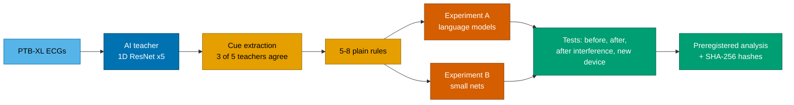
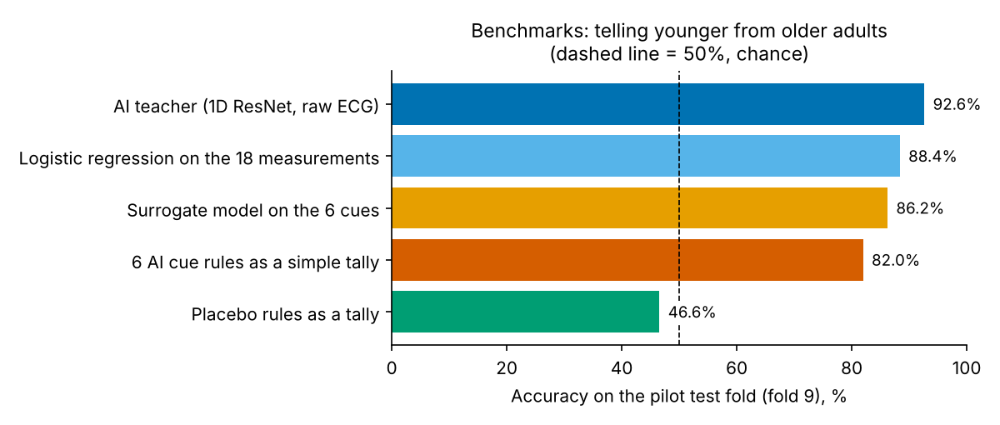
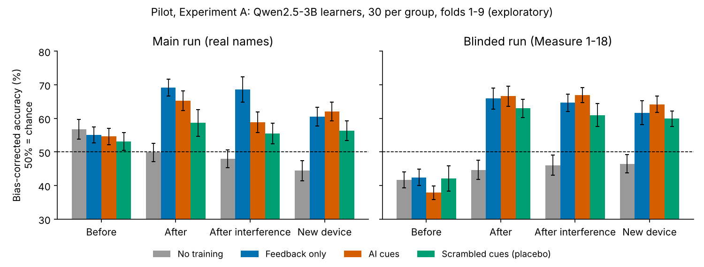
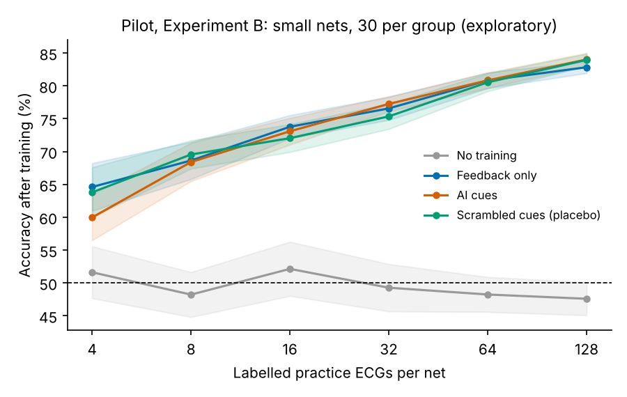
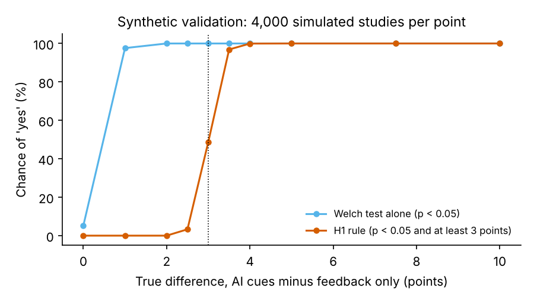

<div align="center">

# 🫀 AI-to-learner knowledge transfer: ECG age

**Can a learner pick up a skill it never had, from cues pulled out of an AI?**

A preregistered, fully computational study. No human participants.

[](prereg/preregistration.md)
[](#-where-the-study-stands)
[](pilot/README.md)

[](LICENSE)
[](https://creativecommons.org/licenses/by/4.0/)
[](requirements.txt)
[](https://physionet.org/content/ptb-xl/1.0.3/)
[](#8-rigor-built-in)
[](prereg/LOCK.json)
[](https://orcid.org/0009-0008-5261-043X)

</div>

**Author:** KEYUR SHAILESHKUMAR PATEL · ORCID [0009-0008-5261-043X](https://orcid.org/0009-0008-5261-043X)<br>
MSc Artificial Intelligence student, Department of Computer Science, Brunel University London, UK · Independent researcher<br>
*Conducted independently; not an official Brunel University London project.*

> [!IMPORTANT]
> **What exists today, in plain words.** The plan for the study is written down and **frozen** (version 1.0.0, 27 November 2026), with SHA-256 fingerprints of the plan, the settings and the code in [`prereg/LOCK.json`](prereg/LOCK.json). The real test has **not been run yet**: it needs a GPU, and its test data (PTB-XL fold 10 and one recording device) are sealed and have never been opened. Everything with real data in this repository comes from an **exploratory pilot** on other folds and does not test any hypothesis.

---

## 💡 The idea in one minute

1. 🤖 **An AI teacher** learns to tell **younger** (under 40) from **older** (65 and over) adults from a raw 12-lead ECG ([PTB-XL](https://physionet.org/content/ptb-xl/1.0.3/)).
2. 🔍 **Its strategy is pulled out** as 5 to 8 plain rules over 18 standard ECG measurements. A real rule from the pilot: *"PR interval: in older adults it tends to be higher (cut-point about 158 ms; lower points to younger)."* Five teachers vote; a rule needs 3 of 5 votes.
3. 🧑‍🎓 **Machine learners are taught** in one of four ways and tested before, right after, after an interfering task, and on ECGs from a device never seen before:

| Group | What the learner gets |
| --- | --- |
| ⬜ **No training** | Nothing, just the tests |
| 🟦 **Feedback only** | 24 practice ECGs with the right answer, and a neutral lesson of the same length |
| 🟧 **AI cues** | The same practice, plus the AI's rules as a lesson |
| 🟩 **Scrambled cues** (placebo) | The same practice, plus a lesson in the same format with rules that do not work |

- **Experiment A (primary):** open-source language models (Qwen2.5-3B, Llama-3.2-3B, Gemma-2-2B), taught in words, **1,002 learners per group**, plus a blinded run where measurement names are hidden.
- **Experiment B (secondary):** small neural nets, taught with data.
- **H1, the main question:** do AI cues beat feedback-only practice by at least **3 points** (one-sided Welch test, alpha 0.05)?
- **H7:** do the AI's real cues beat scrambled cues?



---

## 📍 Where the study stands

| Step | Status |
| --- | --- |
| Design, code, self-checks C1-C17 | ✅ done |
| Synthetic validation (fake worlds with known answers) | ✅ done, 26 of 31 expectations met ([report](validation/VALIDATION_REPORT.pdf)) |
| Exploratory pilot on real data, folds 1-9 | ✅ done ([report](pilot/EXPLORATORY_PILOT_REPORT.pdf), [follow-up](pilot/PILOT_FOLLOWUP.md)) |
| Plan checked against the code, point by point | ✅ 70 of 70 agree ([audit](freeze_audit/audit_prereg_vs_code.json)) |
| Preregistration frozen | ✅ version 1.0.0, 2026-11-27 ([plan](prereg/preregistration.md), [pilot disclosure](prereg/PILOT_DISCLOSURE.md), [lock](prereg/LOCK.json)) |
| OSF registration | ⏳ in preparation |
| Confirmatory run (fold 10, held-out device, 3 models) | ⏳ not started; needs a GPU |

### 🔒 Lock fingerprints (SHA-256)

| What | Fingerprint |
| --- | --- |
| Plan + pilot disclosure (`prereg/*.md`) | `7db89716e09fe4e9f5721cc32e7e1ba22a1e5ef056df1afc7faa9653bb72cee7` |
| Settings (`configs/study.yaml`) | `4c548d8a459ab1772a6b916b6c6b49b0b89b3fa60711646c8d4558de94747e48` |
| Code (`src/**/*.py`) | `38d582dd8b0e8f4e13006c5842fbff98a9d2f7dd45814956ba8b8598a88a0673` |
| Run script (`run_study.py`) | `e44176b4deb881402c5ee6d642a6b89385b0a24facd7219e6ab187324a2b3c72` |

Locked at 2026-11-27T19:05:42Z. If any of these files change, `python run_study.py run` stops.

---

## 📊 Benchmarks (pilot, real data)

> [!NOTE]
> All numbers below are from the **exploratory pilot** on PTB-XL folds 1-9 (teacher trained on folds 1-7, cues from fold 8, tests on fold 9, 610 ECGs). They are not results of the study. Every number is read from the run files by [`scripts/make_figures.py`](scripts/make_figures.py); nothing is typed in by hand.

<p align="center"></p>

| Method (pilot test fold, 610 ECGs) | Accuracy | AUROC |
| --- | --- | --- |
| 🟦 AI teacher (1D ResNet on the raw ECG) | **92.6%** | 0.985 |
| 🟦 Logistic regression on the 18 measurements (baseline) | 88.4% | 0.947 |
| 🟨 Surrogate model on the 6 AI cues | 86.2% | |
| 🟧 The 6 AI cue rules as a simple tally | 82.0% | |
| 🟩 Placebo rules as a tally (meant to be near 50%) | 46.6% | |

In plain words: the AI is very good at the task, and its strategy survives being squeezed into six simple rules (82%). The placebo rules are close to chance, as designed.

---

## 🧪 Pilot results (exploratory, folds 1-9)

### Experiment A: language-model learners (Qwen2.5-3B, 30 per group)

<p align="center"></p>

| Run, post-test | No training | Feedback only | AI cues | Scrambled | H1: cues minus feedback | H7: cues minus scrambled |
| --- | --- | --- | --- | --- | --- | --- |
| Main | 49.9% | 69.2% | 65.3% | 58.7% | -3.9 points (not supported) | +6.6 points, Holm p = 0.02 |
| Blinded | 44.7% | 66.0% | 66.6% | 63.0% | +0.7 points (not supported) | +3.6 points, Holm p = 0.13 |

> [!WARNING]
> **Honest reading.** In the pilot, practice with feedback helped a lot, but the AI's cues did **not** beat feedback-only practice (H1). Real cues beat scrambled cues in the main run (H7). The pilot used one model, 30 learners per group, and a coarser answer read-out that was fixed afterwards (issue P23), so it cannot settle anything. This is exactly why the real test is preregistered.

### Experiment B: small neural nets (secondary)

<p align="center"></p>

With 4 to 128 labelled practice ECGs, nets given the AI's cues never beat nets given feedback only, and scrambled cues did as well as real ones. This is why Experiment B is now **secondary** (decision D13).

---

## ✅ Is the test fair? Synthetic validation

The whole pipeline was also run on fake worlds where the right answer is known (no PTB-XL file was opened for this), and the statistics were simulated at full size (1,002 learners per group, 4,000 simulated studies per point).

<p align="center"></p>

| Property | Result |
| --- | --- |
| False "yes" for H1 when there is no real difference | 0.00% |
| Welch test alone, no real difference | 5.2% (as it should be, about 5%) |
| Chance of "yes" for H1 if the true gain is 3 / 3.5 / 4 points | 49% / 97% / 99.95% |
| Holm family-wise error | 3.75% |
| Expectations met across 6 fake worlds | 26 of 31 (each miss is listed in the [report](validation/VALIDATION_REPORT.pdf)) |
| Two runs from scratch | byte-identical |

---

## 🤖 Use of AI tools

The research questions, hypotheses and design choices are the author's; every judgment call is recorded in [`DECISIONS.md`](DECISIONS.md). The code and draft documents were written with help from an AI assistant (Claude, by Anthropic) under the author's direction and checked by the author. Separately, the study uses AI models as its objects of study.

**Licence.** Code: [MIT](LICENSE). Text and figures: [CC BY 4.0](https://creativecommons.org/licenses/by/4.0/). **Version 1.0.0** (2026-11-27).

---

## 1. Install (once)

Python 3.10-3.13. A GPU is strongly recommended for the full run (NVIDIA with 12 GB+; Apple Silicon works but is slower).

```bash
python -m venv .venv
source .venv/bin/activate            # Windows: .venv\Scripts\activate
pip install -r requirements.txt
```

## 2. Check that everything works (about 1 minute, no downloads)

```bash
python run_study.py smoke
```

This uses fake ECGs and mock learners. Open `runs/<newest>_smoke/REPORT.pdf` (or `.html`). The
numbers mean nothing; it only proves the pipeline runs. An example is in `examples/smoke_run/`.

To repeat the synthetic validation that was done before preregistration (6 fake worlds with known
answers, statistics simulations at full size, a reproducibility re-run and a tamper test; about
1-2 hours on CPU, or `--quick` for about 3 minutes):

```bash
python run_study.py validate
```

The finished validation is in `validation/` (`VALIDATION_REPORT.pdf`).

Run the tests too (they also check that two identical runs give byte-identical results):

```bash
pytest -q
```

## 3. Add your keys (only what you need)

```bash
cp .env.example .env
```

- `HF_TOKEN`: needed for Llama 3.2 and Gemma 2 (gated models). Free at huggingface.co/settings/tokens; also click "accept licence" on each model's page.
- `OPENAI_API_KEY` / `OPENAI_BASE_URL`: only if you switch `experiment_llm.backend` to `openai` (works with vLLM, Ollama, LM Studio or a paid API).

## 4. Preregister and freeze

Steps 1 to 5 were done on 2026-11-27 (version 1.0.0). They are listed so that anyone can see what was done.

1. `prereg/preregistration.md` (the plan) and `prereg/PILOT_DISCLOSURE.md` (what the author saw in the exploratory pilot) were confirmed by the author and frozen. Both files are hashed by `freeze`.
2. `configs/study.yaml` was reviewed. Every value there is part of the preregistration.
3. The learner models are pinned to exact Hugging Face commits (`experiment_llm.revisions`).
4. Check the data against PhysioNet (optional; the run does it anyway): `python run_study.py check-data`
5. Freeze:
   ```bash
   python run_study.py freeze
   ```
   This writes `prereg/LOCK.json` with SHA-256 fingerprints of the prereg, the config and the code.
6. Create the OSF preregistration: paste in `prereg/preregistration.md`, attach `prereg/LOCK.json`,
   `validation/VALIDATION_REPORT.pdf` and the package zip, and put the four printed fingerprints in the
   text. Submit it **before** step 5 below.

## 5. Run the study

```bash
python run_study.py run
```

It refuses to start without `prereg/LOCK.json`. (`python run_study.py run --exploratory` runs the same
pipeline without a lock and labels everything EXPLORATORY.) The first run downloads PTB-XL (~1.7 GB) and PTB-XL+ into `data/`. If the download fails,
the program prints the URL and where to save the file.

Useful options:

```bash
python run_study.py run --only nets            # Experiment B only
python run_study.py run --only llm             # Experiment A only
python run_study.py run --resume runs/<run_id> # continue after a crash; same seeds, no re-draws
python run_study.py verify runs/<run_id>       # re-hash every output against SHA256SUMS.txt
python run_study.py report runs/<run_id>       # rebuild the reports from a run's files
```

If anything in the config, code or prereg changed after locking, the run stops. You can go on
only by declaring it: `--allow-deviation "reason"`; the reason is printed in the report.

### Run times

Measured in the exploratory pilot on **4 CPU cores, no GPU** (ISSUES.md P21). GPU times were not measured.

| Step | Measured on 4 CPU cores | Full study on the same CPU |
| --- | --- | --- |
| Download, unpack, checksum check | about 5 min | same |
| One teacher (five are trained) | about 5 min | about 25 min for five |
| Experiment B | about 5 s per net | about 6 hours (4,008 nets) |
| Experiment A, Qwen2.5-3B | about 3 min per no-training learner; about 11 min per learner with a lesson | not practical (8,016 learners): use a GPU |

A language-model learner with a lesson reads prompts of about 9,000 to 12,000 tokens. Memory: about 13 GB of RAM on CPU for a 3B model. Two settings bound memory if needed: `AI2HUMAN_PREFILL_CHUNK` (tokens per chunk, default 1024) and `AI2HUMAN_KV_BUDGET_GB` (default 1.5).

Results are saved after every language-model learner, so an interrupted run loses at most one learner; continue with `--resume`.

### Exploratory pilot (already done once; see `pilot/`)

```bash
python run_study.py run --pilot 30      # 30 learners per group, folds 1-9 only
```

Pilot mode seals the confirmatory test fold (10) and the held-out device, splits folds 1-9 the same way (teacher 1-7, cues 8, tests 9), labels everything EXPLORATORY, and adds self-check C15 (no sealed ECG was used).

## 6. What you get

Everything lands in `runs/<run_id>/`:

| File | What it is |
| --- | --- |
| `REPORT.pdf`, `REPORT.html`, `REPORT.md` | Full results: the short answer, plain-words summary, self-checks, data, teacher, cues, saliency, every hypothesis with CI, d, p, Holm p and MDE, glossary, common questions |
| `checks.json` | Self-checks C1-C17 (each recomputes something a second way; C15 only in pilot mode) |
| `gate_llm*.json`, `leak_scan*.json` | Known-answer gate, collapse flags, prior-knowledge probe; prompt leak scan |
| `figures/` | Accuracy by group and test, cue weights, teacher training curve |
| `analysis_llm.json`, `analysis_llm_blinded.json`, `analysis_nets.json` | Every statistic, machine-readable |
| `learners_*.csv` | One row per learner (your raw "participant" data) |
| `items_llm*.csv` | One row per learner x test item |
| `*_lesson*.txt`, `example_prompts*/` | Exactly what learners were shown (cue, scrambled, neutral; normal and blinded) |
| `cues.json`, `saliency.json` | The extracted cues, stability path, fidelity, saliency |
| `teacher.pt`, `teacher_seed1-4.pt`, `teacher_metrics.json`, `teacher_predictions.csv` | The AI teacher, the four extra teachers used only for the cue consensus, and their outputs |
| `cohort.csv`, `cohort_summary.json`, `panel_features.csv` | Which ECG went where, and why |
| `config_used.yaml`, `run.log` | Exact settings and the full log |
| `manifest.json` | Hashes of config, prereg and code; environment; package versions; timings |
| `SHA256SUMS.txt` | SHA-256 of every output file (`sha256sum -c SHA256SUMS.txt` verifies them) |

## 7. How it works

```
PTB-XL ECGs ──► cohort + splits ──► AI teacher (1D ResNet, folds 1-8)
                                         │ its guesses on fold 9
                                         ▼
                          cue extraction (stability-selected L1 surrogate,
                          consensus of 5 teacher seeds)
                          + saliency check (integrated gradients)
                                         │ 5-8 rules + 6 clearest cases
                    ┌────────────────────┴────────────────────┐
           Experiment A: LM learners                Experiment B: small nets
   none / feedback / cue / scrambled            none / feedback / cue / scrambled
   (1,002 each; main + blinded runs)                  (1,002 each)
                    └──── pre, post, delayed, transfer (fold 10, held-out device) ────┘
                                         ▼
                          preregistered analysis ──► REPORT + hashes
```

Code map: `src/ai2human/` — `data.py` (download/load), `cohort.py` (labels, splits),
`teacher.py`, `cues.py`, `saliency.py`, `prompts.py` (all learner text), `llm_backends.py`,
`exp_llm.py`, `exp_nets.py`, `sampling.py` (per-learner seeds), `analysis.py`, `stats.py`,
`checks.py` (self-checks), `pipeline.py`, `report.py` + `pdf_report.py`, `validate.py` +
`validation_report.py`, `repro.py` (seeds, hashing, manifest). See `DATA_CARD.md` for the data,
`DECISIONS.md` for every design choice, `ISSUES.md` for every problem found, `PROTOCOL.md` for the
step-by-step protocol.

## 8. Rigor built in

- Fixed master seed; each learner's seed comes from `SeedSequence([seed, experiment, group, learner])`.
- Data checked against PhysioNet's own SHA-256 list and published counts.
- Roles are assigned by patient: no patient is in two roles, and no learner sees the same patient twice.
- Teacher, cue extraction and learner tests use separate folds; the transfer device is removed from all of them.
- Cues come from the AI's guesses, not true ages, so they describe the AI.
- Control groups match the cue group on lesson length (neutral lesson) and on number of examples.
- A placebo group (scrambled cues) separates "the AI's content" from "having a lesson".
- Answer letters are exactly balanced in every group and model; response bias is reported.
- Language models must pass a known-answer gate; collapsed models are flagged; a prior-knowledge probe and a blinded-labels run test for memorised ECG facts.
- Every prompt is scanned for leaks (IDs, sex, device, dates).
- Self-checks C1-C17 recompute key results a second way, at the top of every report.
- Cues must be chosen by at least 3 of 5 independently seeded teachers (C16), and the placebo lesson must score 45-55% by itself on the cue fold (C17).
- Every null result is shown with its minimum detectable effect.
- Language-model answers are read as exact next-token probabilities, not sampled text.
- One primary test; secondary tests Holm-corrected; equivalence test if the primary is null.
- Preregistered precondition checks: teacher AUROC ≥ 0.80; pre-test ≤ 0.65 for a "new skill" claim.
- On CPU, identical runs are byte-identical (checked by `pytest` and by the validation). GPU kernels can differ in the last digits.
- Exact versions in `requirements.lock`; a `Dockerfile` builds the same environment.

## 9. How to cite

PATEL, K. S. (2026). *AI-to-learner knowledge transfer: a preregistered computational study on ECG age*
(Version 1.0.0) [Software]. ORCID: https://orcid.org/0009-0008-5261-043X

Machine-readable metadata is in `CITATION.cff` (GitHub shows a "Cite this repository" button for it).
Please also cite the data: Wagner et al. (2020), PTB-XL, *Scientific Data*; Strodthoff et al. (2023), PTB-XL+, *Scientific Data*.
The OSF registration link and DOI will be added here once it is live.

## 10. Data and model credits

PTB-XL: Wagner et al., *Scientific Data* 2020 (CC BY 4.0). PTB-XL+: Strodthoff et al., *Scientific Data* 2023 (CC BY 4.0).
Learner models keep their own licences (see `prereg/preregistration.md`, section 6).
