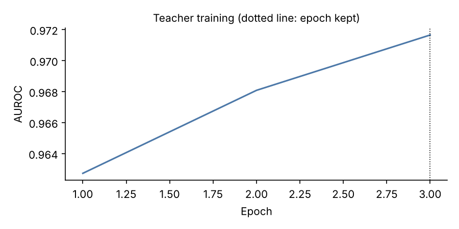
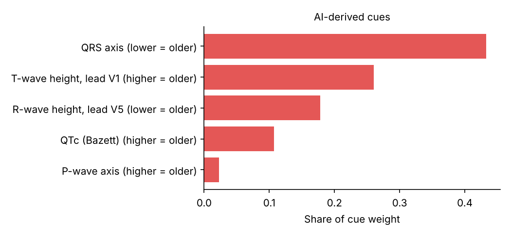
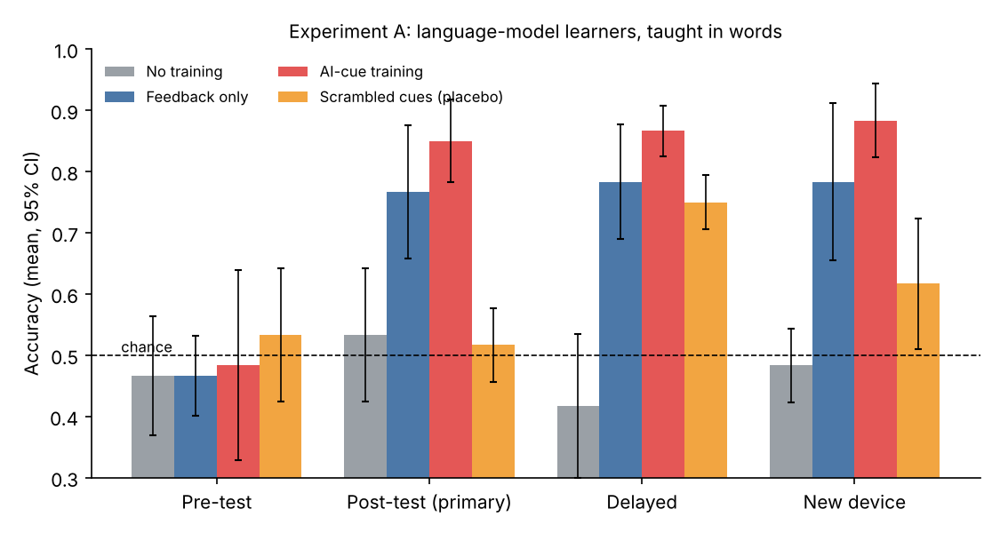
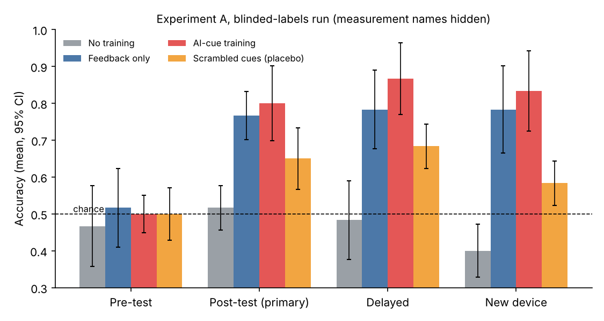
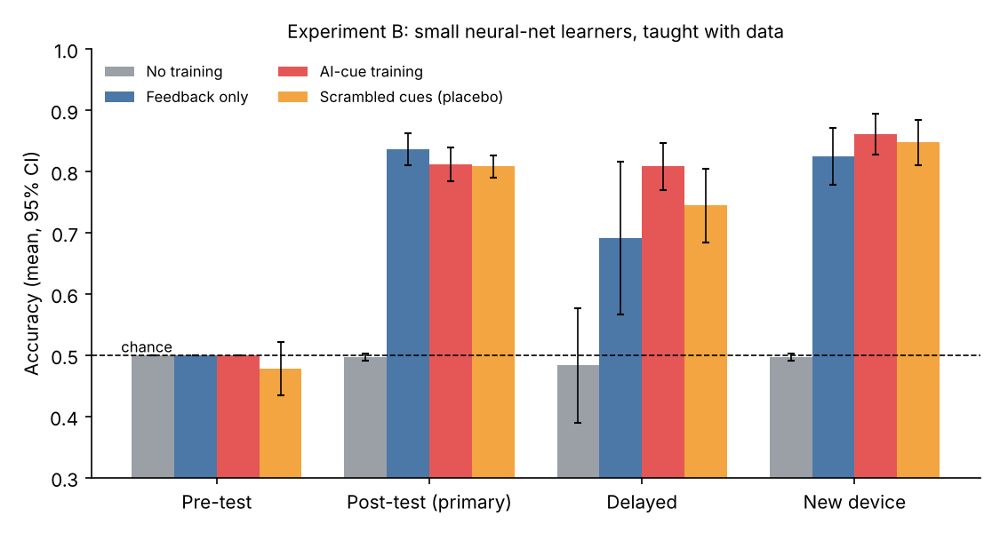

# Can learners acquire a perceptual skill they never had from AI-derived cues? (ECG age)

**Run report - SYNTHETIC DATA - NOT SCIENTIFIC RESULTS**

**KEYUR SHAILESHKUMAR PATEL** · ORCID https://orcid.org/0009-0008-5261-043X  
MSc Artificial Intelligence student, Department of Computer Science, Brunel University London, UK; Independent researcher.  
*Conducted independently; not an official Brunel University London project.*

Run: 20261120T141531Z_smoke  |  Software version 0.5.2  
Preregistration: not applicable (smoke on synthetic data)  
Use of AI tools. The research questions, hypotheses and design choices are the author's. The code and draft documents were written with help from an AI assistant (Claude, by Anthropic) under the author's direction and checked by the author. Separately, the study uses AI models as its objects of study: the AI teacher (a neural network trained here) and the learners (open language models and small neural networks).  
Licence: text and figures CC BY 4.0; code MIT.  


## 1. The short answer

- **These are fake data and fake learners.** The numbers show only that the software works and what it reports.
- Experiment A: right after training, AI-cue learners got 85.0% right; feedback-only learners got 76.7% (difference +8.3 points, 95% range -3.3 points to +20.0 points; one-sided p = 0.119). H1: **NOT SUPPORTED**.
- Experiment A: real cues vs scrambled cues: 85.0% vs 51.7% (difference +33.3 points; Holm p = < 0.001). H7: **supported**.
- Experiment A (blinded run): right after training, AI-cue learners got 80.0% right; feedback-only learners got 76.7% (difference +3.3 points, 95% range -8.3 points to +13.3 points; one-sided p = 0.301). H1: **NOT SUPPORTED**.
- Experiment A (blinded run): real cues vs scrambled cues: 80.0% vs 65.0% (difference +15.0 points; Holm p = 0.100). H7: **not supported**.
- Experiment B: right after training, AI-cue learners got 81.1% right; feedback-only learners got 83.6% (difference -2.5 points, 95% range -5.8 points to +0.7 points; one-sided p = 0.888). H1: **NOT SUPPORTED**.
- Experiment B: real cues vs scrambled cues: 81.1% vs 80.8% (difference +0.3 points; Holm p = 0.873). H7: **not supported**.
- Self-checks: 16 passed, 0 failed, 0 not applicable (Section 3).

> **What this means in plain words.** In Experiment A, learners taught the AI's cues did not do clearly better than learners who only practised with feedback. The test could have found a true difference of about 17.5 points or more most of the time. In Experiment A (blinded run), learners taught the AI's cues did not do clearly better than learners who only practised with feedback. The test could have found a true difference of about 16.4 points or more most of the time. In Experiment B, learners taught the AI's cues did not do clearly better than learners who only practised with feedback. The test could have found a true difference of about 5.2 points or more most of the time.


## 2. What this report is, and what it is not

This run used made-up ECG-like data and mock learners that follow simple scripted rules. It is a test of the machinery, not a finding about real learners. Nothing here may be quoted as a result about ECGs, people or AI models.

It is a fully computational study: the 'learners' are machine learners (language models and small neural networks), not people. It asks whether a skill an AI found can be handed on in a teachable form, which is a first step before any study with people. It does not show that people would learn the same way.


## 3. Can we trust the run? (checks)

Each check recomputes something a second, independent way. A FAIL is shown here and must be explained in ISSUES.md before any number from this run is quoted.

| # | Check | Result | Detail |
| --- | --- | --- | --- |
| C1 | No patient appears in two roles | pass | 0 shared; 101 ECGs set aside |
| C2 | Teacher saw only its training and validation ECGs | pass | train roles ['teacher_train'], early-stopping roles ['teacher_val'] |
| C3 | Cues built only from the cue fold, from the teacher's guesses | pass | 177 ECGs, roles ['cue'] |
| C4 | Learner sets come from the right roles, balanced, one ECG per patient | pass | 60 learners re-drawn from their seeds; problems: none |
| C5 | Seeds reproduce exactly the test items each learner saw | pass | 0 mismatched test sets |
| C6 | Learner accuracies (primary score and raw score) recomputed from the item files | pass | 576 values, largest difference 0.00e+00 |
| C7 | H1 p-values recomputed with a hand-written Welch test | pass | 3 experiments, largest difference 1.2e-16 |
| C8 | Holm adjustment recomputed with statsmodels | pass | 3 families, largest difference 0.0e+00 |
| C9 | Cue-rule accuracy recomputed from the saved files | pass | 0.8643 vs 0.8643 |
| C10 | Prompt leak scan: no IDs, sex, device, site or dates in learner text | pass | 0 flagged case lines, 0 flagged lesson texts |
| C11 | Answer letters balanced: in every group and model, 'older = A' for half the learners (within one) | pass | 24 group-model cells, largest imbalance 0.0 learners |
| C12 | Known-answer gate and which-models-count decisions follow the preregistered rules | pass | 6 model decisions |
| C13 | Scrambled lesson uses features the AI did not pick | pass | 0 shared features; scrambled-rule accuracy on test 0.618 |
| C14 | Teacher weights match their recorded SHA-256 | pass | 5f88b4e33c683414... (+2 consensus teachers) |
| C16 | Cue consensus: every cue was chosen by at least 2 of 3 teachers (recounted) | pass | votes R_AxisFrontal_Global 3, T_Amp_V1 3, R_Amp_V5 3, QT_IntBazett_Global 2, P_AxisFront_Global 1; FALLBACK used |
| C17 | Placebo is neutral: scrambled rules score 45%-55% on the cue fold (recomputed) | pass | 0.531 (draw 1); on the learners' test pool 0.618 |


### Fingerprints (SHA-256)

| Item | SHA-256 |
| --- | --- |
| Preregistration (prereg/*.md) | 2f05f8071115d9866bc5cf618ecc8d24c484fa5eec84eb2b15d09f71e892e1f4 |
| Config (configs/study.yaml) | 568aa80c228c2f20554845b7189c227fe7201514abfa9fbebcb84691a23db52a |
| Code (src/*.py) | d238e56b9c25d6471d7c2d41806e4ef7ad8b492ad05ec674c73caa04dfa7d2ce |


## 4. Data and splits

Source: SYNTHETIC (pipeline test only; not real ECGs). 3000 ECGs, 2516 in the two age groups (under 40 or 65 and over), 2516 with the measurements, from 2188 patients. Roles are given by patient, so no patient is in two roles; 101 ECGs were set aside for this. Held-out device: AT-6 C 5.5.

| Role | ECGs | Older (65+) | Used for |
| --- | --- | --- | --- |
| teacher_train | 1310 | 630 | teaching the AI; learners' practice cases |
| teacher_val | 134 | 70 | stopping the AI's training |
| cue | 177 | 76 | finding the cues |
| test | 199 | 103 | learners' pre, post and delayed tests |
| transfer | 595 | 292 | learners' new-device test |
| unused | 101 | 55 | set aside (patient overlap) |


## 5. The AI teacher

A 1D ResNet read the raw 12-lead ECG and learned to tell younger from older adults. 'Measurements only' is a simple model that sees only the 18 measurements the learners see: it shows how much is possible from those numbers alone.

| Split | AI AUROC | AI accuracy | Measurements-only AUROC | Measurements-only accuracy |
| --- | --- | --- | --- | --- |
| teacher_val | 0.972 | 92.5% | 0.998 | 95.5% |
| cue | 0.976 | 92.1% | 0.991 | 95.5% |
| test | 0.970 | 91.5% | 0.984 | 92.5% |
| transfer | 0.974 | 92.6% | 0.995 | 97.5% |


*Validation AUROC by epoch.*


## 6. The cues taken from the AI

On the cue fold only, a sparse model was fitted to the AI's own guesses (not the true ages); the measurements it kept became plain rules. This is the lesson the AI-cue group reads:

```
LESSON: How an expert AI tells younger (under 40) from older (65+) adults on an ECG.
The AI relies on these measurements, most important first:
1. QRS axis: in older adults it tends to be lower (cut-point about 47 deg; higher points to younger).
2. T-wave height, lead V1: in older adults it tends to be higher (cut-point about 0.02 mV; lower points to younger).
3. R-wave height, lead V5: in older adults it tends to be lower (cut-point about 1.63 mV; higher points to younger).
4. QTc (Bazett): in older adults it tends to be higher (cut-point about 416 ms; lower points to younger).
5. P-wave axis: in older adults it tends to be higher (cut-point about 55 deg; lower points to younger).
No single cue is decisive. Count how many cues point to 'older', giving more weight to the cues near the top of the list, and decide by the balance.
```


*Weight of each cue in the lesson.*

The placebo group reads this lesson instead (same format, measurements the AI did not pick, random directions):

```
LESSON: How an expert AI tells younger (under 40) from older (65+) adults on an ECG.
The AI relies on these measurements, most important first:
1. Q-wave depth, lead III: in older adults it tends to be lower (cut-point about 0.30 mV; higher points to younger).
2. QT interval: in older adults it tends to be higher (cut-point about 387 ms; lower points to younger).
3. PR interval: in older adults it tends to be higher (cut-point about 153 ms; lower points to younger).
4. ST level, lead V5: in older adults it tends to be lower (cut-point about 0.29 mV; higher points to younger).
5. QRS duration: in older adults it tends to be lower (cut-point about 94 ms; higher points to younger).
No single cue is decisive. Count how many cues point to 'older', giving more weight to the cues near the top of the list, and decide by the balance.
```

| Split | Surrogate agrees with AI | Rules agree with AI | Rules right (true age) | Scrambled rules right |
| --- | --- | --- | --- | --- |
| cue | 98.3% | 96.0% | 91.5% | 53.1% |
| test | 97.5% | 89.9% | 86.4% | 61.8% |
| transfer | 96.3% | 92.3% | 88.9% | 60.3% |


### Saliency check (does the AI look where the cues say?)

| ECG segment | Share of AI attention | Share of time | Density ratio |
| --- | --- | --- | --- |
| P | 12.5% | 12.5% | 1.00 |
| QRS | 36.3% | 22.0% | 1.65 |
| ST-T | 38.0% | 48.8% | 0.78 |

Densest attention: QRS. Segment holding most cue weight: QRS. Agree: True.


## 7. Experiment A: language-model learners, taught in words


### Which learner models count

Before a model's learners count, it must follow one explicit rule on 40 cases (at least 85% right). It must also not be flat: fewer than half of its learners may give the same probability to more than half of the post-test cases (such answers cannot be ranked). The share of learners that give one answer to 95% or more of the cases ('collapsed') is shown but does not remove a model, because the primary score does not depend on which letter a learner favours. Models that fail are reported but do not count.

| Model | Gate accuracy | Gate | Learners flat (post) | Learners collapsed (post) | Counts for H1 |
| --- | --- | --- | --- | --- | --- |
| mock-student-1 | 100.0% | pass | 0.0% | 0.0% | yes |
| mock-student-2 | 100.0% | pass | 0.0% | 0.0% | yes |
| mock-student-3 | 100.0% | pass | 0.0% | 0.0% | yes |

Prior-knowledge probe: before any lesson, each model was asked, for each measurement, whether it is usually higher in older adults, twice, with the answer letters swapped. A direction counts as known only when both answers agree; a model that always picks the same letter knows nothing by this rule. High numbers mean the lesson may teach little that is new; the blinded run is the check.

| Model | Cue directions already known | Measurements answered inconsistently |
| --- | --- | --- |
| mock-student-1 | 0 of 5 | 18 of 18 |
| mock-student-2 | 0 of 5 | 18 of 18 |
| mock-student-3 | 0 of 5 | 18 of 18 |


### Results by group

Learners counted: 24 (No training 6, Feedback only 6, AI-cue training 6, Scrambled cues (placebo) 6). Score: bias-corrected accuracy. Each learner's cases on a test are split at that learner's own median probability of 'older' (above = older, below = younger, exactly at the median = half credit). Tests are half older and half younger, so chance is 50% whichever letter a learner favours. The raw score (older when the probability is above 0.5) is under Robustness.

| Group | n | Pre | Post | Delayed | New device |
| --- | --- | --- | --- | --- | --- |
| No training | 6 | 46.7% [37.0%, 56.4%] | 53.3% [42.4%, 64.3%] | 41.7% [29.9%, 53.4%] | 48.3% [42.3%, 54.4%] |
| Feedback only | 6 | 46.7% [40.1%, 53.2%] | 76.7% [65.7%, 87.6%] | 78.3% [69.0%, 87.7%] | 78.3% [65.5%, 91.2%] |
| AI-cue training | 6 | 48.3% [32.8%, 63.9%] | 85.0% [78.3%, 91.7%] | 86.7% [82.5%, 90.8%] | 88.3% [82.3%, 94.4%] |
| Scrambled cues (placebo) | 6 | 53.3% [42.4%, 64.3%] | 51.7% [45.6%, 57.7%] | 75.0% [70.6%, 79.4%] | 61.7% [51.0%, 72.3%] |


*Mean accuracy per group and test, with 95% confidence intervals.*


### Hypotheses

Differences are in percentage points of accuracy. MDE = the smallest true difference this test would find 80% of the time. H1 needs p < 0.05 AND a difference of at least 3 points. H2-H7 are Holm-corrected.

|  | Claim | Diff | 95% CI | d | p | p (Holm) | MDE | Supported |
| --- | --- | --- | --- | --- | --- | --- | --- | --- |
| H1 (primary) | AI-cue training beats feedback only, right after training | +8.3 | [-3.3, +20.0] | 0.74 | 0.119 | - | 17.5 | no |
| H2 | AI-cue training beats no training, right after training | +31.7 | [+20.8, +43.3] | 2.80 | < 0.001 | 0.003 | 17.5 | yes |
| H3 | Feedback only beats no training, right after training | +23.3 | [+11.7, +38.3] | 1.71 | 0.007 | 0.029 | 21.1 | yes |
| H4 | AI-cue training beats feedback only after the interference task (delayed) | +8.3 | [-1.7, +17.5] | 0.92 | 0.078 | 0.233 | 14.0 | no |
| H5 | AI-cue training beats feedback only on the held-out device (transfer) | +10.0 | [-3.3, +21.7] | 0.80 | 0.104 | 0.233 | 19.3 | no |
| H6 | AI-cue learners improve more from pre- to post-test than feedback-only learners | +6.7 | [-15.0, +23.3] | 0.34 | 0.289 | 0.289 | 30.6 | no |
| H7 | The AI's real cues beat scrambled cues in the same format (placebo control) | +33.3 | [+25.0, +41.7] | 4.19 | < 0.001 | < 0.001 | 12.3 | yes |

> **What this means in plain words.** In Experiment A, learners taught the AI's cues did not do clearly better than learners who only practised with feedback. The test could have found a true difference of about 17.5 points or more most of the time.


### Preregistered preconditions

| Check | Value |
| --- | --- |
| teacher_test_auroc | 0.970 |
| teacher_is_expert (AUROC >= 0.80) | True |
| pretest_mean | 0.487 |
| new_skill (pretest mean <= 0.65) | True |


### Robustness checks (reported, not used for the verdict)

- Adjusting for each learner's pre-test score (ANCOVA): cue effect +8.5 points, two-sided p = 0.302.
- Same test on mean probability of the right answer: difference +5.6 points, p = 0.018.
- Item-level model with errors clustered by learner and by ECG (allows for learners sharing test ECGs): +8.3 points, SE 6.05 points, one-sided p = 0.084 (240 answers, 148 distinct ECGs).
- Same test on raw accuracy (older when the probability is above 0.5): difference +10.0 points, p = 0.075.
- Same test on each learner's AUROC (how well its probabilities rank the cases; 0.50 = no information): difference +0.077, p = 0.122.
- Raw accuracy at post-test: AI-cue training 85.8%, Feedback only 75.8%, No training 53.3%, Scrambled cues (placebo) 52.5%.
- AUROC at post-test: AI-cue training 0.923, Feedback only 0.847, No training 0.523, Scrambled cues (placebo) 0.598.
- Share of post-test cases tied at the learner's median (cannot be ranked): AI-cue training 0.0%, Feedback only 0.0%, No training 0.0%, Scrambled cues (placebo) 0.0%.
- Model mock-student-1 alone: +10.0 points, p = 0.146.
- Model mock-student-2 alone: +10.0 points, p = 0.352.
- Model mock-student-3 alone: +5.0 points, p = 0.356.
- Average probability given to 'older' (0.5 = no bias): AI-cue training 0.51, Feedback only 0.53, No training 0.50, Scrambled cues (placebo) 0.50.
- Share of learners whose answers collapsed to one class: Pre-test 0.0%, Post-test (primary) 0.0%, Delayed 0.0%, New device 0.0%.
- Transfer fraction (share of the AI teacher's advantage over chance reached at post-test): No training 0.08, Feedback only 0.64, AI-cue training 0.84, Scrambled cues (placebo) 0.04.


## 8. Experiment A, blinded-labels run (measurement names hidden)


### Which learner models count

Before a model's learners count, it must follow one explicit rule on 40 cases (at least 85% right). It must also not be flat: fewer than half of its learners may give the same probability to more than half of the post-test cases (such answers cannot be ranked). The share of learners that give one answer to 95% or more of the cases ('collapsed') is shown but does not remove a model, because the primary score does not depend on which letter a learner favours. Models that fail are reported but do not count.

| Model | Gate accuracy | Gate | Learners flat (post) | Learners collapsed (post) | Counts for H1 |
| --- | --- | --- | --- | --- | --- |
| mock-student-1 | 100.0% | pass | 0.0% | 0.0% | yes |
| mock-student-2 | 100.0% | pass | 0.0% | 0.0% | yes |
| mock-student-3 | 100.0% | pass | 0.0% | 0.0% | yes |


### Results by group

Learners counted: 24 (No training 6, Feedback only 6, AI-cue training 6, Scrambled cues (placebo) 6). Score: bias-corrected accuracy. Each learner's cases on a test are split at that learner's own median probability of 'older' (above = older, below = younger, exactly at the median = half credit). Tests are half older and half younger, so chance is 50% whichever letter a learner favours. The raw score (older when the probability is above 0.5) is under Robustness.

| Group | n | Pre | Post | Delayed | New device |
| --- | --- | --- | --- | --- | --- |
| No training | 6 | 46.7% [35.7%, 57.6%] | 51.7% [45.6%, 57.7%] | 48.3% [37.7%, 59.0%] | 40.0% [32.8%, 47.2%] |
| Feedback only | 6 | 51.7% [41.0%, 62.3%] | 76.7% [70.1%, 83.2%] | 78.3% [67.7%, 89.0%] | 78.3% [66.6%, 90.1%] |
| AI-cue training | 6 | 50.0% [44.9%, 55.1%] | 80.0% [69.9%, 90.1%] | 86.7% [77.0%, 96.4%] | 83.3% [72.4%, 94.3%] |
| Scrambled cues (placebo) | 6 | 50.0% [42.8%, 57.2%] | 65.0% [56.6%, 73.4%] | 68.3% [62.3%, 74.4%] | 58.3% [52.3%, 64.4%] |


*Mean accuracy per group and test, with 95% confidence intervals.*


### Hypotheses

Differences are in percentage points of accuracy. MDE = the smallest true difference this test would find 80% of the time. H1 needs p < 0.05 AND a difference of at least 3 points. H2-H7 are Holm-corrected.

|  | Claim | Diff | 95% CI | d | p | p (Holm) | MDE | Supported |
| --- | --- | --- | --- | --- | --- | --- | --- | --- |
| H1 (primary) | AI-cue training beats feedback only, right after training | +3.3 | [-8.3, +13.3] | 0.31 | 0.301 | - | 16.4 | no |
| H2 | AI-cue training beats no training, right after training | +28.3 | [+16.7, +38.3] | 2.72 | < 0.001 | 0.004 | 16.1 | yes |
| H3 | Feedback only beats no training, right after training | +25.0 | [+16.7, +33.3] | 3.18 | < 0.001 | < 0.001 | 12.1 | yes |
| H4 | AI-cue training beats feedback only after the interference task (delayed) | +8.3 | [-4.2, +20.0] | 0.66 | 0.141 | 0.424 | 19.6 | no |
| H5 | AI-cue training beats feedback only on the held-out device (transfer) | +5.0 | [-11.7, +17.5] | 0.35 | 0.278 | 0.503 | 21.9 | no |
| H6 | AI-cue learners improve more from pre- to post-test than feedback-only learners | +5.0 | [-9.2, +17.5] | 0.40 | 0.251 | 0.503 | 19.2 | no |
| H7 | The AI's real cues beat scrambled cues in the same format (placebo control) | +15.0 | [+1.7, +26.7] | 1.29 | 0.025 | 0.100 | 18.0 | no |

> **What this means in plain words.** In Experiment A (blinded run), learners taught the AI's cues did not do clearly better than learners who only practised with feedback. The test could have found a true difference of about 16.4 points or more most of the time.


### Preregistered preconditions

| Check | Value |
| --- | --- |
| teacher_test_auroc | 0.970 |
| teacher_is_expert (AUROC >= 0.80) | True |
| pretest_mean | 0.496 |
| new_skill (pretest mean <= 0.65) | True |


### Robustness checks (reported, not used for the verdict)

- Adjusting for each learner's pre-test score (ANCOVA): cue effect +3.8 points, two-sided p = 0.632.
- Same test on mean probability of the right answer: difference +2.2 points, p = 0.216.
- Item-level model with errors clustered by learner and by ECG (allows for learners sharing test ECGs): +3.3 points, SE 5.45 points, one-sided p = 0.270 (240 answers, 147 distinct ECGs).
- Same test on raw accuracy (older when the probability is above 0.5): difference +7.5 points, p = 0.078.
- Same test on each learner's AUROC (how well its probabilities rank the cases; 0.50 = no information): difference +0.028, p = 0.294.
- Raw accuracy at post-test: AI-cue training 79.2%, Feedback only 71.7%, No training 56.7%, Scrambled cues (placebo) 63.3%.
- AUROC at post-test: AI-cue training 0.878, Feedback only 0.850, No training 0.615, Scrambled cues (placebo) 0.680.
- Share of post-test cases tied at the learner's median (cannot be ranked): AI-cue training 0.0%, Feedback only 0.0%, No training 0.0%, Scrambled cues (placebo) 0.0%.
- Model mock-student-1 alone: +10.0 points, p = 0.146.
- Model mock-student-2 alone: +10.0 points, p = 0.250.
- Model mock-student-3 alone: -10.0 points, p = 0.854.
- Average probability given to 'older' (0.5 = no bias): AI-cue training 0.49, Feedback only 0.53, No training 0.50, Scrambled cues (placebo) 0.50.
- Share of learners whose answers collapsed to one class: Pre-test 0.0%, Post-test (primary) 0.0%, Delayed 0.0%, New device 0.0%.
- Transfer fraction (share of the AI teacher's advantage over chance reached at post-test): No training 0.04, Feedback only 0.64, AI-cue training 0.72, Scrambled cues (placebo) 0.36.


## 9. Experiment B: small neural-net learners, taught with data


### Results by group

Learners counted: 24 (No training 6, Feedback only 6, AI-cue training 6, Scrambled cues (placebo) 6).

| Group | n | Pre | Post | Delayed | New device |
| --- | --- | --- | --- | --- | --- |
| No training | 6 | 50.0% [50.0%, 50.0%] | 49.7% [49.2%, 50.3%] | 48.3% [39.0%, 57.6%] | 49.7% [49.2%, 50.3%] |
| Feedback only | 6 | 50.0% [50.0%, 50.0%] | 83.6% [81.0%, 86.2%] | 69.2% [56.7%, 81.7%] | 82.5% [77.8%, 87.2%] |
| AI-cue training | 6 | 50.0% [50.0%, 50.0%] | 81.1% [78.4%, 83.9%] | 80.8% [77.0%, 84.7%] | 86.1% [82.8%, 89.4%] |
| Scrambled cues (placebo) | 6 | 47.8% [43.4%, 52.1%] | 80.8% [79.0%, 82.7%] | 74.4% [68.4%, 80.4%] | 84.7% [81.0%, 88.4%] |


*Mean accuracy per group and test, with 95% confidence intervals.*

This experiment is secondary (decision D13). It is run and analysed exactly as designed, but its H1 is not a primary claim of the study: the preregistration states in advance that no difference between AI cues and feedback only is expected here.


### Hypotheses

Differences are in percentage points of accuracy. MDE = the smallest true difference this test would find 80% of the time. H1 needs p < 0.05 AND a difference of at least 3 points. H2-H7 are Holm-corrected.

|  | Claim | Diff | 95% CI | d | p | p (Holm) | MDE | Supported |
| --- | --- | --- | --- | --- | --- | --- | --- | --- |
| H1 (primary) | AI-cue training beats feedback only, right after training | -2.5 | [-5.8, +0.7] | -0.75 | 0.888 | - | 5.2 | no |
| H2 | AI-cue training beats no training, right after training | +31.4 | [+28.6, +33.6] | 12.65 | < 0.001 | < 0.001 | 3.8 | yes |
| H3 | Feedback only beats no training, right after training | +33.9 | [+31.9, +36.5] | 14.50 | < 0.001 | < 0.001 | 3.6 | yes |
| H4 | AI-cue training beats feedback only after the interference task (delayed) | +11.7 | [+0.3, +23.9] | 1.01 | 0.066 | 0.263 | 17.9 | no |
| H5 | AI-cue training beats feedback only on the held-out device (transfer) | +3.6 | [-1.5, +8.9] | 0.71 | 0.125 | 0.374 | 7.8 | no |
| H6 | AI-cue learners improve more from pre- to post-test than feedback-only learners | -2.5 | [-5.8, +0.7] | -0.75 | 0.888 | 0.888 | 5.2 | no |
| H7 | The AI's real cues beat scrambled cues in the same format (placebo control) | +0.3 | [-3.1, +3.1] | 0.09 | 0.437 | 0.873 | 4.5 | no |

> **What this means in plain words.** In Experiment B, learners taught the AI's cues did not do clearly better than learners who only practised with feedback. The test could have found a true difference of about 5.2 points or more most of the time.


### Preregistered preconditions

| Check | Value |
| --- | --- |
| teacher_test_auroc | 0.970 |
| teacher_is_expert (AUROC >= 0.80) | True |
| pretest_mean | 0.494 |
| new_skill (pretest mean <= 0.65) | True |


### Robustness checks (reported, not used for the verdict)

- Adjusting for each learner's pre-test score (ANCOVA): cue effect -2.5 points, two-sided p = 0.237.
- Same test on mean probability of the right answer: difference -3.5 points, p = 0.986.
- Share of learners whose answers collapsed to one class: Pre-test 95.8%, Post-test (primary) 25.0%, Delayed 25.0%, New device 25.0%.
- Transfer fraction (share of the AI teacher's advantage over chance reached at post-test): No training -0.01, Feedback only 0.81, AI-cue training 0.75, Scrambled cues (placebo) 0.74.


## 10. Problems found

- No self-check failed in this run. Known design limits are listed in ISSUES.md and in Section 11.


## 11. What we can and cannot say


### We can say

- Whether, in this setting, machine learners taught the AI's cues beat machine learners given only feedback (H1), and whether the AI's real cues beat a placebo lesson in the same format (H7).


### We cannot say

- Anything at all about real ECGs or real models: this run used fake data and scripted learners.
- That people would learn the same way. All learners here are machines.
- That the cues are how the AI 'really' works. They are a simple summary that agrees with the AI most of the time (Section 6).
- Anything clinical. Telling younger from older ECGs is a test task, not a diagnosis.


## 12. Words used

| Word | Meaning |
| --- | --- |
| AI teacher | The neural network trained here to tell younger from older adults from the raw ECG. |
| Cue | A plain rule taken from the AI, e.g. 'heart rate tends to be lower in older adults'. |
| Learner | One machine 'participant': one language-model session or one small neural network, with its own cases. |
| Feedback only | Learners practise on cases and are told the right answer, but get no rules. |
| Scrambled cues (placebo) | A lesson that looks the same but uses measurements the AI did not pick, with random directions. |
| Known-answer gate | A test that a model can follow one simple written rule. Models that cannot are not counted. |
| Collapse | When a learner gives the same answer to nearly every case. Its accuracy then says nothing. |
| AUROC | How well a model ranks older above younger; 0.5 is guessing, 1.0 is perfect. |
| p-value | How surprising a result would be if there were no real difference. Small = unlikely to be luck. |
| Holm correction | A rule that makes p-values stricter when several hypotheses are tested together. |
| MDE | Minimum detectable effect: the smallest true difference the test would find 80% of the time. |
| Equivalence test (TOST) | A test of whether a difference is smaller than a set margin, so 'no difference' can be claimed. |
| Preregistration | Publishing the plan before running the test, so it cannot be changed after. |
| SHA-256 | A file fingerprint. Change one letter and the fingerprint changes. |


## 13. How to check this report

- Master seed: 20261026. Every learner's cases and letters come from its own seed, so any learner can be re-made.
- Re-hash every output: python run_study.py verify runs/20261120T141531Z_smoke
- Compare the three fingerprints in Section 3 with prereg/LOCK.json and with the OSF registration.
- All learner-level results are in learners_*.csv; every single answer is in items_*.csv; checks.json holds the self-checks.


## 14. Common questions

| Question | Answer |
| --- | --- |
| Did an AI do the research? | No. The idea, hypotheses and every design choice are the author's. An AI assistant helped write code and drafts under the author's direction. Separately, AI models are what the study tests. |
| Why machines and not people? | It is cheaper, fully repeatable and can use 1,002 learners per group. If cues do not transfer even to machines, a study with people is unlikely to work; if they do, it is the next step. |
| Why a placebo lesson? | A lesson might help just because it is a lesson. The placebo has the same format and length, so only the AI's content differs. |
| Why hide the measurement names in one run? | Language models may already know how ECGs change with age. With names hidden, they can only use what the lesson tells them. |
| What if no model passes the gate? | Then Experiment A gives no answer for H1, and the report says so. The rule was fixed in advance. |
