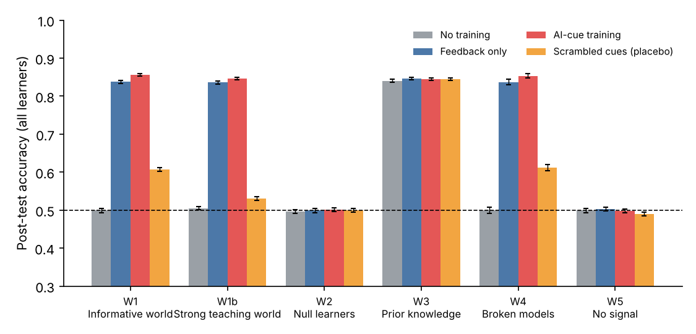
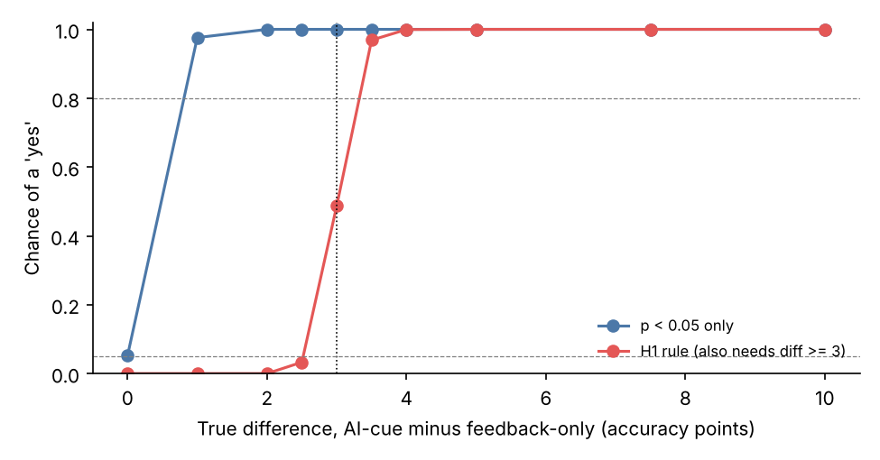

# Can learners acquire a perceptual skill they never had from AI-derived cues? (ECG age)

**Synthetic validation report - SYNTHETIC DATA - NOT SCIENTIFIC RESULTS**

**KEYUR SHAILESHKUMAR PATEL** · ORCID https://orcid.org/0009-0008-5261-043X  
MSc Artificial Intelligence student, Department of Computer Science, Brunel University London, UK; Independent researcher.  
*Conducted independently; not an official Brunel University London project.*

Validation run: 20261120T132404Z_validation  |  Software version 0.5.2  |  full  
Status: exploratory validation made BEFORE preregistration. No real ECGs were used.  
Use of AI tools. The research questions, hypotheses and design choices are the author's. The code and draft documents were written with help from an AI assistant (Claude, by Anthropic) under the author's direction and checked by the author. Separately, the study uses AI models as its objects of study: the AI teacher (a neural network trained here) and the learners (open language models and small neural networks).  
Licence: text and figures CC BY 4.0; code MIT.  

## 1. The short answer

- The pipeline behaved as planned in **26 of 31** pre-stated checks across 6 fake worlds where the right answer was known in advance.
- W1 Informative world: 5 of 7 as expected; NOT as expected: H1 supported (main run); H1 supported (blinded run).
- W1b Strong teaching world: 2 of 4 as expected; NOT as expected: H1 supported (main run); H1 supported (blinded run).
- W2 Null learners: 5 of 5 as expected.
- W3 Prior knowledge: 4 of 5 as expected; NOT as expected: Blinded run still shows the lesson effect (H1 supported).
- W4 Broken models: 6 of 6 as expected.
- W5 No signal: 4 of 4 as expected.
- Large differences are found: real cues beat scrambled cues by +25 points (W1, supported), +32 points (W1b, supported), +24 points (W4, supported) in the worlds where the learners read lessons.
- At the planned size (1,002 learners per group), the H1 rule gave a false 'yes' in 0.00% of simulated no-effect studies (limit 5%). It found a true 5-point effect 100% of the time, a 4-point effect 100% and a 3-point effect only 49%.
- Holm correction kept the chance of any false 'yes' among H2-H7 at 3.8% (limit 5%).
- Re-running the same settings gave byte-identical results (41 files): yes. Changing one byte of a results file was caught: yes.

> **What this means in plain words.** We built 6 pretend worlds where we knew in advance what should happen, and ran the whole study in each. The software said 'the cues help' when they clearly did, 'no' when they did not, caught learners that already knew the answer, threw out broken learners, and noticed when there was nothing to learn. These are machine tests only: they say nothing yet about real ECGs or real AI models. In W1, W1b, W3 the help we planted turned out smaller than the 3-point bar, so the study said 'real but too small to count', which is what the rule is for; our advance guess of the size was too high. One design fact to know: because H1 also needs the observed difference to reach 3 points, a true effect of exactly 3 points is found only about half the time. Effects of 4 points or more are found almost always.

## 2. What this report is, and what it is not

This is the exploratory validation run made before the study is preregistered. It uses made-up ECG-like data and scripted mock learners. Its only job is to show that the software, the checks and the statistics do what the plan says, so that the preregistration can point to it. It may be cited in the preregistration as 'synthetic validation'. It is not a pilot on real data: no PTB-XL record was opened (decision D3).

Each fake world states in advance what the pipeline must report. A world 'passes' only if every one of its statements comes true. The worlds use the preregistered code unchanged; only data size, training length and the learner type are set for the world. Language-model worlds use the full planned number of learners (1,002 per group, main and blinded runs). Neural-net worlds use 30 learners per group to save time; their power at full size is covered by the simulations in Section 5.

## 3. How the fake worlds are built

- Fake ECGs: 12-lead, 10-second signals with patients, folds and recording devices like PTB-XL. In worlds with signal, age shifts some of the 18 measurements and the waveform; in W5 it shifts nothing.
- Mock learners read the same prompts real models would read and answer with a probability for A or B. A 'student' applies any numbered rules it finds and learns a little from practice cases; a 'null' learner ignores lessons; a 'memoriser' already knows the AI's cues when real names are shown; 'collapse' always says 'older' outside the gate; 'random' guesses.
- Neural-net learners are real small networks trained on the fake signals, exactly as in the study.

| World | Story | Learner models | Age signal |
| --- | --- | --- | --- |
| W1 | Age leaves a trace in the ECG and the measurements. Learners read and apply the rules they are given, and learn a little from practice cases. | mock-student-1, mock-student-2, mock-student-3 | yes |
| W1b (added) | Same data as W1, but the learners lean much more on written rules than on practice cases, so a good lesson should give a large gain. Added after the dry run showed W1's planted gain was below 3 points. | mock-strong-1, mock-strong-2, mock-strong-3 | yes |
| W2 | Same data. Learners can follow one explicit rule (so they pass the gate) but learn nothing from lessons or practice: their answers are noise. | mock-null-1, mock-null-2, mock-null-3 | yes |
| W3 | Same data. Learners already 'know' the AI's cues whenever the real measurement names are shown, with or without a lesson, like a model that memorised ECG textbooks. | mock-memorizer-1, mock-memorizer-2, mock-memorizer-3 | yes |
| W4 | One good learner model, one that follows an explicit rule but otherwise always says 'older', and one that answers at random. | mock-student-1, mock-collapse-1, mock-random-1 | yes |
| W5 | Age leaves no trace at all in the ECG or the measurements. There is nothing for the AI to find. | mock-student-1, mock-student-2, mock-student-3 | none |

## 4. Results in each world

*Post-test accuracy by group in each world (language-model learners, main run, all models).*

### W1. Informative world

Age leaves a trace in the ECG and the measurements. Learners read and apply the rules they are given, and learn a little from practice cases.

| Must happen | Happened | What we saw |
| --- | --- | --- |
| No self-check fails | yes | 16 pass, 0 fail, 0 n/a |
| AI teacher is an expert (AUROC >= 0.80) | yes | AUROC 0.973 |
| H1 supported (main run) | NO | diff +1.8 pts, p = 2.02e-11 (significant, but below the 3-point bar) |
| H1 supported (blinded run) | NO | diff +1.7 pts, p = 7.22e-11 (significant, but below the 3-point bar) |
| H7 supported: real cues beat scrambled cues | yes | diff +24.8 pts, p = 0 |
| Pre-test near chance (new skill) | yes | pre-test mean 0.501 |
| All three models count | yes | ['mock-student-1', 'mock-student-2', 'mock-student-3'] |

Language-model learners (main run). Teacher AUROC 0.973; cues: QRS axis, T-wave height, lead V1, R-wave height, lead V5, QRS duration, Heart rate, PR interval; the cue rules alone get 89.3% right on the test fold.

| Group | n | Pre | Post | Delayed | New device |
| --- | --- | --- | --- | --- | --- |
| No training | 1002 | 50.1% [49.6%, 50.6%] | 49.9% [49.4%, 50.4%] | 49.5% [49.0%, 50.0%] | 50.1% [49.6%, 50.7%] |
| Feedback only | 1002 | 49.9% [49.5%, 50.4%] | 83.8% [83.4%, 84.2%] | 83.5% [83.1%, 83.9%] | 83.8% [83.4%, 84.2%] |
| AI-cue training | 1002 | 50.2% [49.7%, 50.6%] | 85.5% [85.2%, 85.9%] | 85.3% [85.0%, 85.7%] | 85.3% [85.0%, 85.7%] |
| Scrambled cues (placebo) | 1002 | 50.2% [49.7%, 50.7%] | 60.8% [60.3%, 61.3%] | 60.6% [60.1%, 61.1%] | 59.8% [59.3%, 60.3%] |

### W1b. Strong teaching world

Same data as W1, but the learners lean much more on written rules than on practice cases, so a good lesson should give a large gain. Added after the dry run showed W1's planted gain was below 3 points.

| Must happen | Happened | What we saw |
| --- | --- | --- |
| No self-check fails | yes | 16 pass, 0 fail, 0 n/a |
| H1 supported (main run) | NO | diff +1.0 pts, p = 0.000104 (significant, but below the 3-point bar) |
| H1 supported (blinded run) | NO | diff +0.5 pts, p = 0.0451 (significant, but below the 3-point bar) |
| H7 supported: real cues beat scrambled cues | yes | diff +31.5 pts, p = 0 |

Language-model learners (main run). Teacher AUROC 0.973; cues: QRS axis, T-wave height, lead V1, R-wave height, lead V5, QRS duration, Heart rate, PR interval; the cue rules alone get 89.3% right on the test fold.

| Group | n | Pre | Post | Delayed | New device |
| --- | --- | --- | --- | --- | --- |
| No training | 1002 | 50.1% [49.6%, 50.6%] | 50.5% [50.0%, 51.0%] | 50.3% [49.8%, 50.8%] | 50.2% [49.7%, 50.7%] |
| Feedback only | 1002 | 50.4% [49.9%, 50.9%] | 83.6% [83.2%, 84.0%] | 83.6% [83.2%, 84.0%] | 83.3% [82.9%, 83.7%] |
| AI-cue training | 1002 | 50.0% [49.5%, 50.5%] | 84.6% [84.2%, 84.9%] | 84.3% [84.0%, 84.7%] | 84.3% [83.9%, 84.7%] |
| Scrambled cues (placebo) | 1002 | 50.3% [49.8%, 50.8%] | 53.1% [52.6%, 53.6%] | 52.8% [52.4%, 53.3%] | 52.6% [52.1%, 53.1%] |

### W2. Null learners

Same data. Learners can follow one explicit rule (so they pass the gate) but learn nothing from lessons or practice: their answers are noise.

| Must happen | Happened | What we saw |
| --- | --- | --- |
| No self-check fails | yes | 16 pass, 0 fail, 0 n/a |
| All models pass the known-answer gate | yes | 1.00, 1.00, 1.00 |
| H1 NOT supported (main run) | yes | diff +0.2 pts, p = 0.317 |
| H1 NOT supported (blinded run) | yes | diff -0.2 pts, p = 0.692 |
| H7 NOT supported | yes | diff +0.1 pts, p = 0.388 |

Language-model learners (main run). Teacher AUROC 0.973; cues: QRS axis, T-wave height, lead V1, R-wave height, lead V5, QRS duration, Heart rate, PR interval; the cue rules alone get 89.3% right on the test fold.

| Group | n | Pre | Post | Delayed | New device |
| --- | --- | --- | --- | --- | --- |
| No training | 1002 | 50.2% [49.7%, 50.7%] | 49.6% [49.1%, 50.1%] | 50.0% [49.6%, 50.5%] | 50.0% [49.5%, 50.5%] |
| Feedback only | 1002 | 49.8% [49.3%, 50.3%] | 49.9% [49.4%, 50.4%] | 49.8% [49.3%, 50.3%] | 49.9% [49.4%, 50.4%] |
| AI-cue training | 1002 | 50.4% [49.9%, 50.9%] | 50.0% [49.6%, 50.5%] | 50.0% [49.5%, 50.5%] | 49.2% [48.7%, 49.7%] |
| Scrambled cues (placebo) | 1002 | 50.1% [49.6%, 50.6%] | 49.9% [49.5%, 50.4%] | 50.4% [49.9%, 50.9%] | 49.6% [49.1%, 50.1%] |

### W3. Prior knowledge

Same data. Learners already 'know' the AI's cues whenever the real measurement names are shown, with or without a lesson, like a model that memorised ECG textbooks.

| Must happen | Happened | What we saw |
| --- | --- | --- |
| No self-check fails | yes | 16 pass, 0 fail, 0 n/a |
| Probe shows the models already know most cue directions | yes | [6, 6, 6] of 6 |
| Main run: pre-test far above chance, so the 'new skill' precondition fails | yes | pre-test mean 0.842 |
| Blinded run: pre-test back near chance | yes | pre-test mean 0.498 |
| Blinded run still shows the lesson effect (H1 supported) | NO | diff +1.5 pts, p = 2.52e-08 (significant, but below the 3-point bar) |

Language-model learners (main run). Teacher AUROC 0.973; cues: QRS axis, T-wave height, lead V1, R-wave height, lead V5, QRS duration, Heart rate, PR interval; the cue rules alone get 89.3% right on the test fold.

| Group | n | Pre | Post | Delayed | New device |
| --- | --- | --- | --- | --- | --- |
| No training | 1002 | 84.2% [83.9%, 84.6%] | 84.0% [83.7%, 84.4%] | 84.4% [84.1%, 84.8%] | 83.8% [83.4%, 84.1%] |
| Feedback only | 1002 | 84.2% [83.8%, 84.5%] | 84.6% [84.2%, 85.0%] | 84.0% [83.6%, 84.4%] | 84.2% [83.8%, 84.5%] |
| AI-cue training | 1002 | 83.9% [83.6%, 84.3%] | 84.4% [84.1%, 84.8%] | 84.0% [83.7%, 84.4%] | 83.8% [83.4%, 84.2%] |
| Scrambled cues (placebo) | 1002 | 84.4% [84.0%, 84.7%] | 84.5% [84.2%, 84.9%] | 84.4% [84.0%, 84.7%] | 83.9% [83.5%, 84.2%] |

### W4. Broken models

One good learner model, one that follows an explicit rule but otherwise always says 'older', and one that answers at random.

| Must happen | Happened | What we saw |
| --- | --- | --- |
| No self-check fails | yes | 16 pass, 0 fail, 0 n/a |
| Random model fails the gate | yes | gate accuracy 0.47 |
| Collapsing model passes the gate but is flagged (collapsed, and flat: its answers cannot be ranked) | yes | gate 1.00, collapsed learners 100%, flat learners 100% |
| Only the good model counts for H1 | yes | ['mock-student-1'] |
| H1 still testable on the good model | yes | diff +1.6 pts, p = 0.000221 (significant, but below the 3-point bar) |
| Sensitivity analysis with all models is reported | yes | diff +0.4 pts, p = 0.298 |

Language-model learners (main run). Teacher AUROC 0.973; cues: QRS axis, T-wave height, lead V1, R-wave height, lead V5, QRS duration, Heart rate, PR interval; the cue rules alone get 89.3% right on the test fold.

| Group | n | Pre | Post | Delayed | New device |
| --- | --- | --- | --- | --- | --- |
| No training | 334 | 49.6% [48.8%, 50.5%] | 50.0% [49.1%, 50.8%] | 49.8% [49.0%, 50.5%] | 50.7% [49.9%, 51.6%] |
| Feedback only | 334 | 50.4% [49.6%, 51.3%] | 83.7% [83.0%, 84.4%] | 83.9% [83.3%, 84.6%] | 83.8% [83.0%, 84.6%] |
| AI-cue training | 334 | 50.3% [49.5%, 51.1%] | 85.4% [84.8%, 86.0%] | 85.4% [84.8%, 86.0%] | 85.4% [84.9%, 86.0%] |
| Scrambled cues (placebo) | 334 | 50.1% [49.3%, 50.9%] | 61.2% [60.3%, 62.0%] | 60.6% [59.8%, 61.5%] | 60.3% [59.4%, 61.1%] |

### W5. No signal

Age leaves no trace at all in the ECG or the measurements. There is nothing for the AI to find.

| Must happen | Happened | What we saw |
| --- | --- | --- |
| No self-check fails | yes | 16 pass, 0 fail, 0 n/a |
| Teacher near chance, so the 'expert' precondition fails | yes | AUROC 0.496 |
| H1 NOT supported (language-model learners) | yes | diff -0.5 pts, p = 0.935 |
| H1 NOT supported (neural-net learners) | yes | diff +0.2 pts, p = 0.454 |

Language-model learners (main run). Teacher AUROC 0.496; cues: QRS axis, Heart rate, R-wave height, lead V5, QRS duration, QTc (Bazett), T-wave height, lead V1; the cue rules alone get 48.4% right on the test fold.

| Group | n | Pre | Post | Delayed | New device |
| --- | --- | --- | --- | --- | --- |
| No training | 1002 | 50.1% [49.6%, 50.6%] | 49.9% [49.4%, 50.4%] | 49.5% [49.0%, 50.0%] | 50.1% [49.6%, 50.7%] |
| Feedback only | 1002 | 49.9% [49.5%, 50.4%] | 50.3% [49.8%, 50.7%] | 49.7% [49.3%, 50.2%] | 50.1% [49.6%, 50.6%] |
| AI-cue training | 1002 | 50.2% [49.7%, 50.6%] | 49.7% [49.2%, 50.2%] | 50.1% [49.6%, 50.6%] | 50.1% [49.6%, 50.6%] |
| Scrambled cues (placebo) | 1002 | 50.2% [49.7%, 50.7%] | 48.9% [48.5%, 49.4%] | 49.3% [48.8%, 49.7%] | 49.7% [49.2%, 50.2%] |

## 5. How the statistics behave at the planned size (1,002 per group)

Simulated learners were given the spread seen in W1 (feedback-only mean 83.8%, SD 6.3 points, 40 test items each). Each figure below is from 4,000 simulated studies.

*Chance that the study says 'yes' for H1, by the true size of the effect. Dotted line: the preregistered minimum meaningful difference.*

| True difference (points) | p < 0.05 | H1 rule (p < 0.05 and >= 3 points) |
| --- | --- | --- |
| 0.0 | 5.2% | 0.0% |
| 1.0 | 97.6% | 0.0% |
| 2.0 | 100.0% | 0.0% |
| 2.5 | 100.0% | 3.3% |
| 3.0 | 100.0% | 48.8% |
| 3.5 | 100.0% | 96.9% |
| 4.0 | 100.0% | 100.0% |
| 5.0 | 100.0% | 100.0% |
| 7.5 | 100.0% | 100.0% |
| 10.0 | 100.0% | 100.0% |

- False 'yes' for H1 when there is no effect: 0.00% (Welch test alone: 5.22%).
- Chance of at least one false 'yes' among H2-H7 after Holm correction, when nothing works: 3.8%.
- Learners sharing test ECGs: with 300 learners per group drawing from 400 ECGs of mixed difficulty, the learner-level Welch test said 'yes' falsely 5.0% of the time and the item-level two-way cluster test 5.3% (300 simulated studies; 5% is right).

### Known-answer gate and collapse rule

| Model's true rule-following accuracy | Chance it passes the gate (>= 34 of 40) |
| --- | --- |
| 50% | 0.0% |
| 60% | 0.1% |
| 70% | 2.4% |
| 75% | 9.6% |
| 80% | 28.6% |
| 85% | 60.7% |
| 90% | 90.0% |
| 95% | 99.7% |

| Learner's lean toward one answer | Chance it is flagged as collapsed (>= 38 of 40 the same) |
| --- | --- |
| 50% | 0.00% |
| 60% | 0.00% |
| 70% | 0.01% |
| 80% | 0.79% |
| 90% | 22.28% |
| 95% | 67.67% |
| 99% | 99.25% |

## 6. Reproducibility and tamper test

- The W1 settings (reduced size) were run twice from scratch. 41 result files compared (logs and run IDs left out): identical = True.
- `verify` on the second run before tampering: all match. After changing one byte in learners_llm.csv: caught (learners_llm.csv). After putting it back: all match.

## 7. Problems found and what changed

- W1: expected 'H1 supported (main run)' but saw diff +1.8 pts, p = 2.02e-11 (significant, but below the 3-point bar). Why: the mock learners already score about 83% from 30 practice cases, so the planted lesson adds only 1 to 2 points. The H1 rule correctly calls a gain this size detectable but not meaningful. The advance expectation was set too high; it is kept as written (ISSUES.md P9, P10).
- W1: expected 'H1 supported (blinded run)' but saw diff +1.7 pts, p = 7.22e-11 (significant, but below the 3-point bar). Why: the mock learners already score about 83% from 30 practice cases, so the planted lesson adds only 1 to 2 points. The H1 rule correctly calls a gain this size detectable but not meaningful. The advance expectation was set too high; it is kept as written (ISSUES.md P9, P10).
- W1b: expected 'H1 supported (main run)' but saw diff +1.0 pts, p = 0.000104 (significant, but below the 3-point bar). Why: the mock learners already score about 83% from 30 practice cases, so the planted lesson adds only 1 to 2 points. The H1 rule correctly calls a gain this size detectable but not meaningful. The advance expectation was set too high; it is kept as written (ISSUES.md P9, P10).
- W1b: expected 'H1 supported (blinded run)' but saw diff +0.5 pts, p = 0.0451 (significant, but below the 3-point bar). Why: the mock learners already score about 83% from 30 practice cases, so the planted lesson adds only 1 to 2 points. The H1 rule correctly calls a gain this size detectable but not meaningful. The advance expectation was set too high; it is kept as written (ISSUES.md P9, P10).
- W3: expected 'Blinded run still shows the lesson effect (H1 supported)' but saw diff +1.5 pts, p = 2.52e-08 (significant, but below the 3-point bar). Why: the mock learners already score about 83% from 30 practice cases, so the planted lesson adds only 1 to 2 points. The H1 rule correctly calls a gain this size detectable but not meaningful. The advance expectation was set too high; it is kept as written (ISSUES.md P9, P10).
- Design property (not a bug): requiring the observed difference to reach 3 points means a true 3-point effect is found only 49% of the time; 80% power is reached at about 4 points. The preregistration states this.

## 8. What we can and cannot say

### We can say

- The software, self-checks and statistics behave as the plan says in the situations tested here.
- At the planned size the H1 rule keeps false positives well under 5% and finds effects of 4 points or more almost always.
- The gate, collapse rule, prior-knowledge probe and blinded run each catch the problem they were built for.

### We cannot say

- Anything about real ECGs, real AI models, or people. Mock learners are scripts.
- That real language models will pass the gate or not collapse. That is only known when the study runs.
- That the real effect, if any, is as large as in W1. W1 was built to have an effect.

## 9. Words used

| Word | Meaning |
| --- | --- |
| AI teacher | The neural network trained here to tell younger from older adults from the raw ECG. |
| Cue | A plain rule taken from the AI, e.g. 'heart rate tends to be lower in older adults'. |
| Learner | One machine 'participant': one language-model session or one small neural network, with its own cases. |
| Feedback only | Learners practise on cases and are told the right answer, but get no rules. |
| Scrambled cues (placebo) | A lesson that looks the same but uses measurements the AI did not pick, with random directions. |
| Known-answer gate | A test that a model can follow one simple written rule. Models that cannot are not counted. |
| Collapse | When a learner gives the same answer to nearly every case. Its accuracy then says nothing. |
| AUROC | How well a model ranks older above younger; 0.5 is guessing, 1.0 is perfect. |
| p-value | How surprising a result would be if there were no real difference. Small = unlikely to be luck. |
| Holm correction | A rule that makes p-values stricter when several hypotheses are tested together. |
| MDE | Minimum detectable effect: the smallest true difference the test would find 80% of the time. |
| Equivalence test (TOST) | A test of whether a difference is smaller than a set margin, so 'no difference' can be claimed. |
| Preregistration | Publishing the plan before running the test, so it cannot be changed after. |
| SHA-256 | A file fingerprint. Change one letter and the fingerprint changes. |
| Mock learner | A small script that pretends to be a learner, used only to test the software. |
| Synthetic world | Made-up data and learners where the right answer is known in advance. |
| Power | The chance that the study finds an effect that is really there. |

## 10. How to check this report

- Re-make it: python run_study.py validate (about an hour on a laptop CPU; add --quick for a 10-minute version).
- Every file in this folder is listed with its SHA-256 in SHA256SUMS.txt; each world folder has its own manifest and SHA256SUMS.txt.
- validation_summary.json holds every number in this report.
- Master seed 20261026; simulations use seed 20261125.

## 11. Common questions

| Question | Answer |
| --- | --- |
| Did an AI do the research? | No. The idea, hypotheses and every design choice are the author's. An AI assistant helped write code and drafts under the author's direction. |
| Why test on fake data first? | So that any bug is found before the plan is locked, without looking at the real data and without being tempted to change the plan after seeing real results. |
| Why didn't you run a small real pilot? | Decided in advance (D3): looking at real data before locking the plan would weaken the preregistration. The fake worlds test the machinery instead. |
| Can these numbers go in a paper as results? | No. They can be cited as validation of the method, labelled synthetic. |

## Appendix A. Hypothesis tables for every world

### W1 Informative world: llm

|  | Claim | Diff | 95% CI | d | p | p (Holm) | MDE | Supported |
| --- | --- | --- | --- | --- | --- | --- | --- | --- |
| H1 (primary) | AI-cue training beats feedback only, right after training | +1.8 | [+1.2, +2.3] | 0.30 | < 0.001 | - | 0.7 | no |
| H2 | AI-cue training beats no training, right after training | +35.7 | [+35.0, +36.3] | 5.14 | < 0.001 | < 0.001 | 0.8 | yes |
| H3 | Feedback only beats no training, right after training | +33.9 | [+33.3, +34.6] | 4.67 | < 0.001 | < 0.001 | 0.8 | yes |
| H4 | AI-cue training beats feedback only after the interference task (delayed) | +1.8 | [+1.3, +2.4] | 0.31 | < 0.001 | < 0.001 | 0.7 | yes |
| H5 | AI-cue training beats feedback only on the held-out device (transfer) | +1.6 | [+1.1, +2.1] | 0.26 | < 0.001 | < 0.001 | 0.7 | yes |
| H6 | AI-cue learners improve more from pre- to post-test than feedback-only learners | +1.5 | [+0.7, +2.3] | 0.16 | < 0.001 | < 0.001 | 1.1 | yes |
| H7 | The AI's real cues beat scrambled cues in the same format (placebo control) | +24.8 | [+24.2, +25.4] | 3.63 | < 0.001 | < 0.001 | 0.8 | yes |

### W1 Informative world: llm_blinded

|  | Claim | Diff | 95% CI | d | p | p (Holm) | MDE | Supported |
| --- | --- | --- | --- | --- | --- | --- | --- | --- |
| H1 (primary) | AI-cue training beats feedback only, right after training | +1.7 | [+1.2, +2.3] | 0.29 | < 0.001 | - | 0.7 | no |
| H2 | AI-cue training beats no training, right after training | +35.7 | [+35.1, +36.3] | 5.15 | < 0.001 | < 0.001 | 0.8 | yes |
| H3 | Feedback only beats no training, right after training | +33.9 | [+33.3, +34.6] | 4.70 | < 0.001 | < 0.001 | 0.8 | yes |
| H4 | AI-cue training beats feedback only after the interference task (delayed) | +1.2 | [+0.6, +1.7] | 0.19 | < 0.001 | < 0.001 | 0.7 | yes |
| H5 | AI-cue training beats feedback only on the held-out device (transfer) | +1.6 | [+1.1, +2.1] | 0.26 | < 0.001 | < 0.001 | 0.7 | yes |
| H6 | AI-cue learners improve more from pre- to post-test than feedback-only learners | +2.0 | [+1.1, +2.8] | 0.20 | < 0.001 | < 0.001 | 1.2 | yes |
| H7 | The AI's real cues beat scrambled cues in the same format (placebo control) | +24.3 | [+23.7, +24.9] | 3.53 | < 0.001 | < 0.001 | 0.8 | yes |

### W1 Informative world: nets

|  | Claim | Diff | 95% CI | d | p | p (Holm) | MDE | Supported |
| --- | --- | --- | --- | --- | --- | --- | --- | --- |
| H1 (primary) | AI-cue training beats feedback only, right after training | +2.2 | [+0.1, +4.4] | 0.53 | 0.022 | - | 2.6 | no |
| H2 | AI-cue training beats no training, right after training | +37.4 | [+32.2, +42.5] | 3.53 | < 0.001 | < 0.001 | 6.9 | yes |
| H3 | Feedback only beats no training, right after training | +35.3 | [+30.1, +40.4] | 3.29 | < 0.001 | < 0.001 | 7.0 | yes |
| H4 | AI-cue training beats feedback only after the interference task (delayed) | +0.4 | [-6.1, +6.7] | 0.03 | 0.453 | 0.453 | 8.3 | no |
| H5 | AI-cue training beats feedback only on the held-out device (transfer) | +2.7 | [+0.1, +5.3] | 0.50 | 0.029 | 0.059 | 3.5 | no |
| H6 | AI-cue learners improve more from pre- to post-test than feedback-only learners | +2.7 | [+0.6, +4.9] | 0.62 | 0.009 | 0.028 | 2.8 | yes |
| H7 | The AI's real cues beat scrambled cues in the same format (placebo control) | +3.1 | [+1.0, +5.2] | 0.74 | 0.003 | 0.011 | 2.7 | yes |

### W1b Strong teaching world: llm

|  | Claim | Diff | 95% CI | d | p | p (Holm) | MDE | Supported |
| --- | --- | --- | --- | --- | --- | --- | --- | --- |
| H1 (primary) | AI-cue training beats feedback only, right after training | +1.0 | [+0.5, +1.5] | 0.17 | < 0.001 | - | 0.7 | no |
| H2 | AI-cue training beats no training, right after training | +34.1 | [+33.5, +34.6] | 5.19 | < 0.001 | < 0.001 | 0.8 | yes |
| H3 | Feedback only beats no training, right after training | +33.1 | [+32.5, +33.6] | 4.70 | < 0.001 | < 0.001 | 0.8 | yes |
| H4 | AI-cue training beats feedback only after the interference task (delayed) | +0.8 | [+0.2, +1.3] | 0.13 | 0.003 | 0.003 | 0.7 | yes |
| H5 | AI-cue training beats feedback only on the held-out device (transfer) | +0.9 | [+0.4, +1.5] | 0.15 | < 0.001 | < 0.001 | 0.7 | yes |
| H6 | AI-cue learners improve more from pre- to post-test than feedback-only learners | +1.4 | [+0.5, +2.3] | 0.14 | < 0.001 | 0.002 | 1.2 | yes |
| H7 | The AI's real cues beat scrambled cues in the same format (placebo control) | +31.5 | [+30.9, +32.1] | 4.69 | < 0.001 | < 0.001 | 0.8 | yes |

### W1b Strong teaching world: llm_blinded

|  | Claim | Diff | 95% CI | d | p | p (Holm) | MDE | Supported |
| --- | --- | --- | --- | --- | --- | --- | --- | --- |
| H1 (primary) | AI-cue training beats feedback only, right after training | +0.5 | [-0.1, +1.0] | 0.08 | 0.045 | - | 0.7 | no |
| H2 | AI-cue training beats no training, right after training | +34.3 | [+33.7, +34.9] | 4.76 | < 0.001 | < 0.001 | 0.8 | yes |
| H3 | Feedback only beats no training, right after training | +33.8 | [+33.1, +34.5] | 4.61 | < 0.001 | < 0.001 | 0.8 | yes |
| H4 | AI-cue training beats feedback only after the interference task (delayed) | +0.5 | [+0.0, +1.1] | 0.09 | 0.022 | 0.067 | 0.7 | no |
| H5 | AI-cue training beats feedback only on the held-out device (transfer) | +0.3 | [-0.3, +0.8] | 0.04 | 0.161 | 0.322 | 0.7 | no |
| H6 | AI-cue learners improve more from pre- to post-test than feedback-only learners | -0.1 | [-1.1, +0.8] | -0.01 | 0.629 | 0.629 | 1.2 | no |
| H7 | The AI's real cues beat scrambled cues in the same format (placebo control) | +30.8 | [+30.2, +31.4] | 4.42 | < 0.001 | < 0.001 | 0.8 | yes |

### W2 Null learners: llm

|  | Claim | Diff | 95% CI | d | p | p (Holm) | MDE | Supported |
| --- | --- | --- | --- | --- | --- | --- | --- | --- |
| H1 (primary) | AI-cue training beats feedback only, right after training | +0.2 | [-0.5, +0.8] | 0.02 | 0.317 | - | 0.9 | no |
| H2 | AI-cue training beats no training, right after training | +0.4 | [-0.3, +1.1] | 0.05 | 0.115 | 0.687 | 0.9 | no |
| H3 | Feedback only beats no training, right after training | +0.3 | [-0.4, +1.0] | 0.03 | 0.239 | 1.000 | 0.9 | no |
| H4 | AI-cue training beats feedback only after the interference task (delayed) | +0.2 | [-0.5, +0.9] | 0.03 | 0.264 | 1.000 | 0.9 | no |
| H5 | AI-cue training beats feedback only on the held-out device (transfer) | -0.7 | [-1.4, +0.0] | -0.09 | 0.976 | 1.000 | 0.9 | no |
| H6 | AI-cue learners improve more from pre- to post-test than feedback-only learners | -0.4 | [-1.4, +0.6] | -0.04 | 0.792 | 1.000 | 1.3 | no |
| H7 | The AI's real cues beat scrambled cues in the same format (placebo control) | +0.1 | [-0.6, +0.8] | 0.01 | 0.388 | 1.000 | 0.9 | no |

### W2 Null learners: llm_blinded

|  | Claim | Diff | 95% CI | d | p | p (Holm) | MDE | Supported |
| --- | --- | --- | --- | --- | --- | --- | --- | --- |
| H1 (primary) | AI-cue training beats feedback only, right after training | -0.2 | [-0.9, +0.5] | -0.02 | 0.692 | - | 0.9 | no |
| H2 | AI-cue training beats no training, right after training | -0.4 | [-1.2, +0.3] | -0.05 | 0.877 | 1.000 | 0.9 | no |
| H3 | Feedback only beats no training, right after training | -0.2 | [-1.0, +0.5] | -0.03 | 0.754 | 1.000 | 0.9 | no |
| H4 | AI-cue training beats feedback only after the interference task (delayed) | -0.4 | [-1.1, +0.3] | -0.05 | 0.886 | 1.000 | 0.9 | no |
| H5 | AI-cue training beats feedback only on the held-out device (transfer) | -0.6 | [-1.3, +0.1] | -0.07 | 0.952 | 1.000 | 0.9 | no |
| H6 | AI-cue learners improve more from pre- to post-test than feedback-only learners | -0.5 | [-1.5, +0.5] | -0.04 | 0.814 | 1.000 | 1.3 | no |
| H7 | The AI's real cues beat scrambled cues in the same format (placebo control) | -0.6 | [-1.3, +0.2] | -0.07 | 0.937 | 1.000 | 0.9 | no |

### W3 Prior knowledge: llm

|  | Claim | Diff | 95% CI | d | p | p (Holm) | MDE | Supported |
| --- | --- | --- | --- | --- | --- | --- | --- | --- |
| H1 (primary) | AI-cue training beats feedback only, right after training | -0.2 | [-0.7, +0.4] | -0.03 | 0.732 | - | 0.7 | no |
| H2 | AI-cue training beats no training, right after training | +0.4 | [-0.1, +0.9] | 0.07 | 0.056 | 0.281 | 0.7 | no |
| H3 | Feedback only beats no training, right after training | +0.6 | [+0.1, +1.1] | 0.10 | 0.016 | 0.094 | 0.7 | no |
| H4 | AI-cue training beats feedback only after the interference task (delayed) | +0.0 | [-0.5, +0.5] | 0.00 | 0.469 | 1.000 | 0.7 | no |
| H5 | AI-cue training beats feedback only on the held-out device (transfer) | -0.4 | [-0.9, +0.2] | -0.06 | 0.915 | 1.000 | 0.7 | no |
| H6 | AI-cue learners improve more from pre- to post-test than feedback-only learners | +0.1 | [-0.7, +0.8] | 0.01 | 0.442 | 1.000 | 1.0 | no |
| H7 | The AI's real cues beat scrambled cues in the same format (placebo control) | -0.1 | [-0.6, +0.4] | -0.01 | 0.616 | 1.000 | 0.7 | no |

### W3 Prior knowledge: llm_blinded

|  | Claim | Diff | 95% CI | d | p | p (Holm) | MDE | Supported |
| --- | --- | --- | --- | --- | --- | --- | --- | --- |
| H1 (primary) | AI-cue training beats feedback only, right after training | +1.5 | [+1.0, +2.0] | 0.24 | < 0.001 | - | 0.7 | no |
| H2 | AI-cue training beats no training, right after training | +35.1 | [+34.5, +35.7] | 4.97 | < 0.001 | < 0.001 | 0.8 | yes |
| H3 | Feedback only beats no training, right after training | +33.6 | [+33.0, +34.3] | 4.54 | < 0.001 | < 0.001 | 0.9 | yes |
| H4 | AI-cue training beats feedback only after the interference task (delayed) | +1.2 | [+0.7, +1.7] | 0.20 | < 0.001 | < 0.001 | 0.7 | yes |
| H5 | AI-cue training beats feedback only on the held-out device (transfer) | +1.8 | [+1.2, +2.3] | 0.29 | < 0.001 | < 0.001 | 0.7 | yes |
| H6 | AI-cue learners improve more from pre- to post-test than feedback-only learners | +1.1 | [+0.3, +2.0] | 0.11 | 0.005 | 0.005 | 1.1 | yes |
| H7 | The AI's real cues beat scrambled cues in the same format (placebo control) | +24.3 | [+23.8, +24.9] | 3.61 | < 0.001 | < 0.001 | 0.8 | yes |

### W4 Broken models: llm

|  | Claim | Diff | 95% CI | d | p | p (Holm) | MDE | Supported |
| --- | --- | --- | --- | --- | --- | --- | --- | --- |
| H1 (primary) | AI-cue training beats feedback only, right after training | +1.6 | [+0.8, +2.6] | 0.27 | < 0.001 | - | 1.2 | no |
| H2 | AI-cue training beats no training, right after training | +35.4 | [+34.3, +36.4] | 5.13 | < 0.001 | < 0.001 | 1.3 | yes |
| H3 | Feedback only beats no training, right after training | +33.7 | [+32.6, +34.8] | 4.68 | < 0.001 | < 0.001 | 1.4 | yes |
| H4 | AI-cue training beats feedback only after the interference task (delayed) | +1.5 | [+0.6, +2.4] | 0.26 | < 0.001 | 0.001 | 1.1 | yes |
| H5 | AI-cue training beats feedback only on the held-out device (transfer) | +1.7 | [+0.6, +2.7] | 0.26 | < 0.001 | 0.001 | 1.3 | yes |
| H6 | AI-cue learners improve more from pre- to post-test than feedback-only learners | +1.7 | [+0.3, +3.2] | 0.18 | 0.011 | 0.011 | 1.9 | yes |
| H7 | The AI's real cues beat scrambled cues in the same format (placebo control) | +24.2 | [+23.2, +25.2] | 3.59 | < 0.001 | < 0.001 | 1.3 | yes |

### W4 Broken models: llm_blinded

|  | Claim | Diff | 95% CI | d | p | p (Holm) | MDE | Supported |
| --- | --- | --- | --- | --- | --- | --- | --- | --- |
| H1 (primary) | AI-cue training beats feedback only, right after training | +1.8 | [+0.9, +2.7] | 0.30 | < 0.001 | - | 1.2 | no |
| H2 | AI-cue training beats no training, right after training | +35.5 | [+34.5, +36.6] | 5.09 | < 0.001 | < 0.001 | 1.4 | yes |
| H3 | Feedback only beats no training, right after training | +33.7 | [+32.6, +34.8] | 4.62 | < 0.001 | < 0.001 | 1.4 | yes |
| H4 | AI-cue training beats feedback only after the interference task (delayed) | +0.9 | [-0.1, +1.8] | 0.14 | 0.037 | 0.037 | 1.2 | yes |
| H5 | AI-cue training beats feedback only on the held-out device (transfer) | +1.0 | [+0.2, +2.0] | 0.17 | 0.013 | 0.026 | 1.2 | yes |
| H6 | AI-cue learners improve more from pre- to post-test than feedback-only learners | +2.0 | [+0.4, +3.5] | 0.20 | 0.004 | 0.013 | 1.9 | yes |
| H7 | The AI's real cues beat scrambled cues in the same format (placebo control) | +24.1 | [+23.0, +25.2] | 3.28 | < 0.001 | < 0.001 | 1.4 | yes |

### W5 No signal: llm

|  | Claim | Diff | 95% CI | d | p | p (Holm) | MDE | Supported |
| --- | --- | --- | --- | --- | --- | --- | --- | --- |
| H1 (primary) | AI-cue training beats feedback only, right after training | -0.5 | [-1.2, +0.1] | -0.07 | 0.935 | - | 0.9 | no |
| H2 | AI-cue training beats no training, right after training | -0.1 | [-0.8, +0.5] | -0.02 | 0.656 | 1.000 | 0.9 | no |
| H3 | Feedback only beats no training, right after training | +0.4 | [-0.3, +1.1] | 0.05 | 0.137 | 0.684 | 0.9 | no |
| H4 | AI-cue training beats feedback only after the interference task (delayed) | +0.4 | [-0.3, +1.1] | 0.05 | 0.151 | 0.684 | 0.9 | no |
| H5 | AI-cue training beats feedback only on the held-out device (transfer) | -0.1 | [-0.8, +0.7] | -0.01 | 0.566 | 1.000 | 0.9 | no |
| H6 | AI-cue learners improve more from pre- to post-test than feedback-only learners | -0.8 | [-1.7, +0.2] | -0.07 | 0.947 | 1.000 | 1.2 | no |
| H7 | The AI's real cues beat scrambled cues in the same format (placebo control) | +0.8 | [+0.1, +1.5] | 0.10 | 0.013 | 0.077 | 0.9 | no |

### W5 No signal: llm_blinded

|  | Claim | Diff | 95% CI | d | p | p (Holm) | MDE | Supported |
| --- | --- | --- | --- | --- | --- | --- | --- | --- |
| H1 (primary) | AI-cue training beats feedback only, right after training | +0.6 | [-0.2, +1.3] | 0.07 | 0.056 | - | 0.9 | no |
| H2 | AI-cue training beats no training, right after training | +0.3 | [-0.4, +1.1] | 0.04 | 0.167 | 0.667 | 0.9 | no |
| H3 | Feedback only beats no training, right after training | -0.2 | [-0.9, +0.5] | -0.03 | 0.731 | 1.000 | 0.9 | no |
| H4 | AI-cue training beats feedback only after the interference task (delayed) | -0.9 | [-1.6, -0.2] | -0.12 | 0.996 | 1.000 | 0.9 | no |
| H5 | AI-cue training beats feedback only on the held-out device (transfer) | -0.2 | [-0.9, +0.6] | -0.02 | 0.678 | 1.000 | 0.9 | no |
| H6 | AI-cue learners improve more from pre- to post-test than feedback-only learners | +0.8 | [-0.2, +1.8] | 0.07 | 0.052 | 0.260 | 1.3 | no |
| H7 | The AI's real cues beat scrambled cues in the same format (placebo control) | +1.3 | [+0.6, +2.0] | 0.16 | < 0.001 | < 0.001 | 0.9 | yes |

### W5 No signal: nets

|  | Claim | Diff | 95% CI | d | p | p (Holm) | MDE | Supported |
| --- | --- | --- | --- | --- | --- | --- | --- | --- |
| H1 (primary) | AI-cue training beats feedback only, right after training | +0.2 | [-2.6, +2.9] | 0.03 | 0.454 | - | 3.6 | no |
| H2 | AI-cue training beats no training, right after training | +0.6 | [-2.1, +3.3] | 0.11 | 0.337 | 1.000 | 3.6 | no |
| H3 | Feedback only beats no training, right after training | +0.4 | [-2.5, +3.4] | 0.08 | 0.385 | 1.000 | 3.8 | no |
| H4 | AI-cue training beats feedback only after the interference task (delayed) | -0.6 | [-3.0, +1.9] | -0.11 | 0.670 | 1.000 | 3.2 | no |
| H5 | AI-cue training beats feedback only on the held-out device (transfer) | -1.4 | [-4.8, +2.2] | -0.20 | 0.774 | 1.000 | 4.6 | no |
| H6 | AI-cue learners improve more from pre- to post-test than feedback-only learners | -0.1 | [-2.8, +2.5] | -0.02 | 0.531 | 1.000 | 3.5 | no |
| H7 | The AI's real cues beat scrambled cues in the same format (placebo control) | -0.1 | [-2.9, +2.8] | -0.01 | 0.515 | 1.000 | 3.7 | no |

## Appendix B. Self-checks in every world

| World | C1 | C2 | C3 | C4 | C5 | C6 | C7 | C8 | C9 | C10 | C11 | C12 | C13 | C14 | C16 | C17 |
| --- | --- | --- | --- | --- | --- | --- | --- | --- | --- | --- | --- | --- | --- | --- | --- | --- |
| W1 | pass | pass | pass | pass | pass | pass | pass | pass | pass | pass | pass | pass | pass | pass | pass | pass |
| W1b | pass | pass | pass | pass | pass | pass | pass | pass | pass | pass | pass | pass | pass | pass | pass | pass |
| W2 | pass | pass | pass | pass | pass | pass | pass | pass | pass | pass | pass | pass | pass | pass | pass | pass |
| W3 | pass | pass | pass | pass | pass | pass | pass | pass | pass | pass | pass | pass | pass | pass | pass | pass |
| W4 | pass | pass | pass | pass | pass | pass | pass | pass | pass | pass | pass | pass | pass | pass | pass | pass |
| W5 | pass | pass | pass | pass | pass | pass | pass | pass | pass | pass | pass | pass | pass | pass | pass | pass |
